# How ASSIST works

This is the internal reference for ASSIST (**A**utonomous **S**atellite **S**ignal **I**mitator **S**tation). The
[README](README.md) tells you *how to use* it. This document tells you *how it is built*: what every module does, what a
number looks like at each step on its way from a line of YAML to a byte on a TCP socket, and why it is built that way.
[PLUGINS.md](PLUGINS.md) is the guide for writing a signal, a platform or a sink of your own; section 18 here explains
the machinery behind it.

It follows the code as it is today (branch `dev`, version 0.1.0). File and function names are given so you can jump
straight to the source. Numbers quoted as "measured" come from running the code on the bundled `profiles/vhf137`
profile and a scenario with the rounded fallback station (55.5 N, 37.1 E, 172 m).

**Contents**

1. [The ten-minute mental model](#1-the-ten-minute-mental-model)
2. [Vocabulary](#2-vocabulary)
3. [The rules everything else follows](#3-the-rules-everything-else-follows)
4. [Repository map](#4-repository-map)
5. [Life of a config](#5-life-of-a-config)
6. [Time, orbits, geometry and the link budget](#6-time-orbits-geometry-and-the-link-budget)
7. [The emitter model: carrier, schedule, modulation, fade](#7-the-emitter-model-carrier-schedule-modulation-fade)
8. [Signal kinds, one by one](#8-signal-kinds-one-by-one)
9. [The render engine: from emitters to bytes](#9-the-render-engine-from-emitters-to-bytes)
10. [The C++ kernels and their numpy twins](#10-the-c-kernels-and-their-numpy-twins)
11. [Outputs: files, waterfall, rtl_tcp, run.json, workers](#11-outputs-files-waterfall-rtl_tcp-runjson-workers)
12. [Truth, passes and the catalog](#12-truth-passes-and-the-catalog)
13. [Every command, traced](#13-every-command-traced)
14. [The profile subsystem (offline)](#14-the-profile-subsystem-offline)
15. [Tests and CI](#15-tests-and-ci)
16. [A worked example, end to end](#16-a-worked-example-end-to-end)
17. [Limits, caveats and known discrepancies](#17-limits-caveats-and-known-discrepancies)
18. [Extension points: registries, plugins and the public API](#18-extension-points-registries-plugins-and-the-public-api)
19. [Glossary of symbols and units](#19-glossary-of-symbols-and-units)

---

## 1. The ten-minute mental model

ASSIST fakes the output of an RTL-SDR dongle: a stream of **2 400 000 complex samples per second, each sample two
unsigned bytes** (I then Q, centred on 127.5), tuned to **137.000 MHz**. You describe the sky in a YAML *scenario*;
ASSIST computes what the dongle would have recorded and either serves it over the `rtl_tcp` protocol (so SDR++ or
any other client thinks it is talking to a real dongle) or writes it to disk. From the same scenario it can also
tell you the *truth*: exactly which signal is where, with what Doppler shift and level, at every moment.

The whole program is organised around one promise:

> **The stream is a pure function of the resolved scenario and the absolute sample index.**
> `bytes[n0 : n0+n] = F(resolved_scenario, n0, n)`, for any `n0` and `n`, on any number of worker processes.

Everything unusual in the design (integer millihertz, keyed random streams, 1-second chunks, overlap-add with
carried tails, counter-based noise) exists to keep that promise. A render of minutes 40 to 41 of a day is bit-identical
to the same minute cut out of a render that started at midnight. Adding a source never changes what any other source does.

### The pipeline in one picture

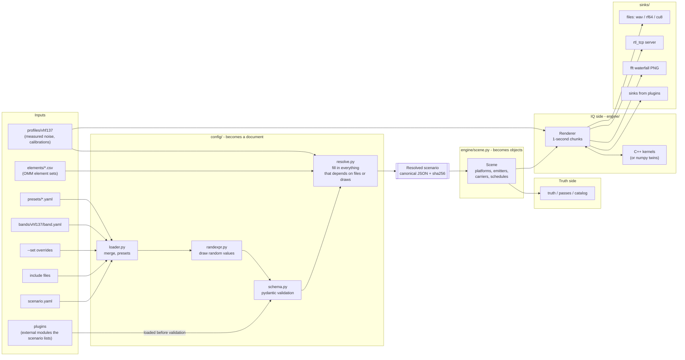

Read it left to right: a text file becomes a *document* (dicts), the document is validated into typed models, the
models are *resolved* into a frozen, self-contained, hashable scenario, and that scenario is turned into live objects
(the *scene*). The scene feeds two independent consumers: the **truth** code (cheap, analytic) and the **renderer**
(expensive, produces samples). The renderer's bytes go to *sinks*, driven by one command, `assist run`.

Signal kinds, platforms and sinks are looked up by name in three registries. The ones shipped with ASSIST and the
ones a scenario brings along as plugins are registered the same way ([section 18](#18-extension-points-registries-plugins-and-the-public-api)).

### The signal chain in one picture

This is what happens to each second of stream. Every box is explained in [section 9](#9-the-render-engine-from-emitters-to-bytes).

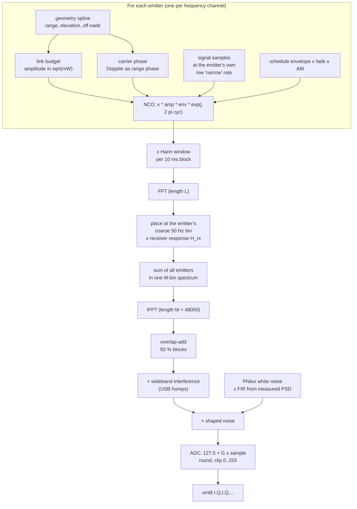

The key trick is the middle: instead of generating every signal at 2.4 MS/s and adding them, each signal is generated
at *its own small sample rate* (a 4800 sym/s ORBCOMM channel at 38 400 S/s, a CW zombie at 11 000 S/s), then
moved to its place in the 2.4 MHz band by *placing its spectrum into a big FFT*. One inverse FFT per 10 ms serves all
~50 emitters at once.

---

## 2. Vocabulary

| Term | Meaning |
|---|---|
| **Scenario** | The YAML (or JSON) file: seed, clock, station, sources, sinks. |
| **Resolved scenario** | The same thing after every draw, lookup and solve has been made. Self-contained, canonical JSON, hashed. A resolved file is itself a valid scenario and resolves to itself. |
| **Band** | `src/assist/bands/<name>/`: front-end defaults, calibrations, named channels (`S-5`). Only `vhf137` exists. |
| **Profile** | `profiles/vhf137/`: measured data from the real station (noise shape, ADC sigma, METEOR/ORBCOMM calibrations, terrestrial statistics). |
| **Preset** | A ready-made source in `src/assist/presets/` (`zombie`, `meteor_lrpt`, `orbcomm`, ...). |
| **Source** | One transmitting object (satellite, ground station, group of receiver spurs). Has a platform and one or more emitters. |
| **Platform** | Where a source is. `satellite` (orbit, Doppler, passes), `ground` (fixed received level, no geometry), `local` (inside the receiver), or one from a plugin. |
| **Capability** | A class attribute of a platform (`fixed`, `needs_orbit`, `level_mode`, ...) that says what a source on it may have. The code asks for capabilities, never for platform names. |
| **Emitter** | One transmitted signal of a source: a signal kind, a frequency, a schedule, a level, an antenna pattern. |
| **Signal** | The modulation (`cw`, `oqpsk`, `lora`, ...). Produces unit-power complex samples at a low rate. |
| **Schedule** | When an emitter transmits: `continuous`, `on_off`, `exp_gaps`, `poisson_events`. |
| **Event** | One burst of an event schedule (a LoRa packet, a VDL burst, a push-to-talk). |
| **Level** | How strong: `cn0_zenith_dbhz`, `cal`, `p_tx_dbw` (the link budget: satellites) or `cn0_dbhz`, `rx_dbm` (a received level: every other platform). |
| **Carrier** | The frequency model of an emitter: rest frequency, per-pass offset and drift. |
| **fs** | Wideband sample rate, 2 400 000 Hz. |
| **Hop N** | 10 ms of stream: `N = fs / 100 = 24 000` samples. The synthesis step. |
| **Block** | Two hops (`M = 2N = 48 000` samples); block `b` covers samples `[bN, bN + 2N)`. Blocks overlap by 50 %. |
| **Chunk** | 100 hops = 1 second = 2 400 000 samples = 4 800 000 output bytes. The unit of work of the engine. Chunk `c` starts at Unix second `c`. |
| **Narrow rate** | The low sample rate an individual emitter's signal is generated at. |
| **Coarse bin** | The 50 Hz FFT bin nearest an emitter's frequency (`f_bin = fc + k * 50 Hz`). The residual offset is handled at the narrow rate. |
| **Control samples** | Per-emitter values (amplitude, carrier phase) computed at 1000 per second and interpolated to the narrow rate. |
| **AOS / TCA / LOS** | Acquisition / time of closest approach (culmination) / loss of signal of a pass. |
| **Pass key** (`aos_key`) | The first whole Unix second at or above the horizon. Seeds the per-pass random draws. |
| **Truth** | Analytic ground truth (frequency, Doppler, level...) computed without rendering any samples. |
| **Sink** | Where the uint8 stream goes: `wav`, `cu8`, `fft` (push sinks, fed piece by piece) or `rtl_tcp` (a serving sink, with clients). Listed under `sinks:`, driven by `assist run`. |
| **Registry** | A table from names to classes (`registry.py`). There are three: signals, platforms, sinks. |
| **Plugin** | An external Python module a scenario lists under `plugins:`. It registers signals, platforms or sinks through `assist.api`. |
| **RNG scope** (`RngScope`) | One consumer's share of the scenario's randomness: every key it can form starts with its prefix. |
| **ADRIFT** | The tracker/classifier ASSIST was built to test (appears in comments). |

---

## 3. The rules everything else follows

These eight rules are the reason the code looks the way it does. When something seems over-engineered, it is almost
always serving one of them.

### Rule 1 - Time is an absolute integer grid

Sample `n` is at Unix time `n / fs`. In 2026, `n` is about 4.3e15 at 2.4 MS/s, which is below 2^53, so it is exact both
as a Python `int` and as a `float64`. Float Unix times only resolve about 0.24 microseconds, so **sample positions are always
integers and float times are derived from them, never the other way round** (`timebase.sample_at` does exact integer
arithmetic on microseconds). A render does not have a "start": it has an arbitrary absolute window of one infinite stream.

### Rule 2 - Random draws are keyed by *names*, never by position

`rng.KeyedRng(seed).stream(*key)` returns a numpy `Generator` seeded from `SeedSequence(seed, spawn_key=hash(key))`,
where each string in the key is hashed with BLAKE2b (8 bytes) and integers are used as-is. Keys look like
`("resolve", "z1", "emitters[carrier].freq_hz")` or `("z1", "carrier", "pass", 1793000000)` or
`("vdl-air-136.975", "vdl", "slot", 497222)`. Because nothing depends on list order or Python's salted `hash()`,
**adding or removing a source cannot change any other source's draws**. There is a test for exactly that
(`test_adding_a_source_changes_no_other_signal`).

Consumers do not hold the `KeyedRng` or the seed. Each gets an **`RngScope`**: a key prefix with `stream(*parts)`,
`key64(*parts)` and `child(*parts)`, which prepend the prefix. An emitter's scope is `(source_id, emitter_id)` (the
class `Keys`), shared by its carrier, schedule and signal. A platform's is `("platform", platform name, source_id)`, a
sink's `("sink", sink name)`, and a signal kind from a plugin gets its emitter's keys under `("signal", kind)`. Two
scopes with different prefixes can never produce the same key, so a module cannot reach another module's draws, and
adding a plugin changes nobody else's numbers. Key parts are strings or non-negative integers (`key_int` rejects
anything else).

### Rule 3 - Streams of bits and noise are counter-based

Anything that must be addressable at an arbitrary index (payload bytes, noise samples) uses **Philox4x32-10**, a counter-based
generator: the output at counter `c` can be computed without computing counters `0 .. c-1`. The counter is always an
*absolute* index: the frame number of a METEOR CADU, the 4096-symbol block of an ORBCOMM stream, the burst start in
microseconds, the hop number of the noise. `KeyedRng.key64(*key)` derives the 64-bit Philox key from the same seed sequence.

### Rule 4 - Frequencies are integer millihertz, times are integer milliseconds

Frequencies are quantised to 1 mHz and carried as Python/`int64` integers (`carrier.to_mhz`). Control samples live
on whole Unix milliseconds. The carrier phase `(f - f_bin) * t` is then *the product of two integers*
(mHz x ms = micro-cycles) and can be reduced modulo one cycle **exactly** with Python integers, so a carrier stays
phase-exact however far from the Unix epoch you are. Phase would otherwise lose resolution: 137 MHz x 1.8e9 s is 2.5e17 cycles,
far beyond float64's 2^53.

### Rule 5 - Work is cut into 1-second chunks that depend only on the chunk index

Chunk `c` is computed from the resolved scenario and `c` alone. The one place chunks touch is the 50 % overlap between
blocks; the engine handles that by recomputing the overlapping half-block on its own when a render starts mid-stream
(see [9.6](#96-the-overlap-add-synthesiser)). Result: any window is identical to the corresponding slice of a longer one,
and worker processes can take any chunk in any order.

### Rule 6 - Resolve once, then everything is pure

All non-determinism (`now`, random expressions, which element set, solving a synthetic pass, calibrated levels) is
frozen at *resolve* time into the resolved scenario. After that no code reads the clock, the filesystem (except profile
arrays) or the network. Workers rebuild their own `Renderer` from the canonical JSON string alone.

### Rule 7 - Every kernel has two implementations

The hot numeric kernels exist twice: C++ (`cpp/`, pybind11 module `assist._dsp`) and numpy (`src/assist/dsp_ref/`). Integer
kernels (`white`, `adc`, `random_bytes`, `conv_encode`, `ccsds_randomise`) match **bit for bit**; float kernels agree
to rounding. `ASSIST_PURE=1` selects numpy. This keeps the C++ honest (`tests/test_dsp_ref.py`) and gives a fallback and a readable specification.

### Rule 8 - Fail loudly

Every pydantic model has `extra="forbid"`, so a typo is an error. A frequency that would leave an emitter's narrow
band raises `RenderError` instead of aliasing silently. Unsupported options (`ppm != 0`) and unknown names (a signal kind, platform or sink that is neither core nor from a listed plugin)
are refused at validation. Output files are never overwritten without `--force`; element snapshots are never overwritten at all.

---

## 4. Repository map

```
ASSIST/
├── README.md                    user documentation
├── HOW-IT-WORKS.md              this file
├── PLUGINS.md                   guide to writing a signal, a platform or a sink
├── pyproject.toml               package metadata, ruff/ty/pytest config, scikit-build-core build of the C++ module
├── CMakeLists.txt               builds assist._dsp (pybind11 + pocketfft), -O3 -ffp-contract=off
├── uv.lock                      pinned dependency set
├── .github/workflows/python-app.yml   CI: ruff, ruff format, ty, uv lock --check, pytest
├── .pre-commit-config.yaml      ruff, ruff-format, ty on commit
│
├── cpp/                         C++17 kernels (single-threaded, GIL released)
│   ├── bindings.cpp             pybind11 glue: argument checking, `out=` buffers, GIL release
│   ├── synth.cpp/.hpp           overlap-add synthesiser (the heart of the engine)
│   ├── frontend.cpp/.hpp        Philox white noise + Box-Muller, overlap-save noise shaping, ADC
│   ├── modem.cpp/.hpp           random_bytes, polyphase pulse shaping, LoRa chirps, NCO
│   ├── conv.cpp/.hpp            K=7 r=1/2 convolutional encoder, CCSDS randomiser
│   ├── basic.hpp, fft.hpp       small helpers; batched pocketfft wrapper
│   ├── philox.hpp               Philox4x32-10 round function
│   └── third_party/             vendored pocketfft_hdronly.h
│
├── src/assist/
│   ├── cli.py                   `assist` command (typer): every command except the `profile` group
│   ├── api.py                   the public interface: everything a plugin imports
│   ├── registry.py              Registry: names -> classes, for signals, platforms and sinks (core and external)
│   ├── plugins.py               loads the plugins a scenario lists; API_VERSION; provenance
│   ├── testing.py               conformance checks for signals, platforms and sinks
│   ├── backend.py               picks assist._dsp (C++) or assist.dsp_ref (numpy)
│   ├── _dsp.pyi                 type stubs of the C++ module
│   ├── rng.py                   KeyedRng and RngScope (rule 2)
│   ├── timebase.py              Unix time, ISO parsing, durations, the sample grid (rule 1)
│   ├── station.py               Station dataclass + station-file reader
│   ├── truth.py                 `assist truth`: rows and events
│   ├── measure.py               IQ measurement helpers (used by tests)
│   ├── waterfall.py             the capture script's FFT-waterfall maths (used by profile tool and tests)
│   │
│   ├── config/                  text -> validated, resolved document
│   │   ├── loader.py            YAML 1.2, includes, deep merge, --set, band defaults, presets
│   │   ├── randexpr.py          uniform(), normal(), randint(), choice(), sample(), bernoulli()
│   │   ├── schema.py            pydantic models of a scenario (extra=forbid)
│   │   └── resolve.py           resolve_document(): fills in draws, elements, passes, levels; hashes
│   │
│   ├── bands/vhf137/
│   │   ├── band.yaml            front-end defaults, calibrations, named channels
│   │   └── terrestrial_default.yaml   ~20 measured terrestrial sources (generated; do not edit by hand)
│   ├── presets/*.yaml           zombie, meteor_lrpt, orbcomm, spacebee, vdl_ground, vdl_aircraft, atc_am, carrier_138, usb_humps, birdies
│   │
│   ├── orbits/                  everything about where satellites are
│   │   ├── elements.py          OMM/TLE readers, ElementStore, snapshot download (the only network code)
│   │   ├── geometry.py          Skyfield evaluation, SplineGeometry (hourly cubic-spline blocks), passes
│   │   ├── synthetic.py         Kepler -> SGP4 satellite; solve a circular orbit for (AOS, max elevation)
│   │   ├── perturb.py           make the true orbit differ from the published one
│   │   └── catalog.py           `assist catalog`: what the tracker under test is given
│   │
│   ├── platforms/
│   │   ├── base.py              Platform ABC, capabilities, PlatformContext, register_platform
│   │   ├── satellite.py         `satellite`: truth orbit, SplineGeometry
│   │   └── fixed.py             `ground` and `local`: no geometry
│   ├── emitters/
│   │   ├── link.py              antenna patterns, FSPL, T_sys, link budget, calibration constants
│   │   ├── carrier.py           f_tx(t) = rest + pass offset + drift, in integer mHz
│   │   ├── schedules.py         continuous / on_off / exp_gaps / poisson_events, AM tumble model
│   │   └── emitter.py           Emitter dataclass: level(), truth(), event_truth()
│   │
│   ├── signals/                 one class per modulation, all behind the Signal ABC (base.py: Signal, Keys, register_signal)
│   │   └── cw, oqpsk, oqpsk_burst, sdpsk, lora, d8psk, gfsk, am, noise (noise_band, noise_comb), pulse (shared RRC)
│   │
│   ├── engine/                  scene -> bytes
│   │   ├── scene.py             Scene: builds platforms/emitters/schedules from the resolved scenario
│   │   ├── control.py           EmitterRender: narrow rate, coarse bin, control samples, narrow streams
│   │   ├── synth.py             synth_blocks(): hands narrow streams to dsp.synth
│   │   ├── frontend.py          noise spec, FIR design, receiver response, noise, ADC
│   │   ├── wideband.py          WideRender: time-domain interference added before the ADC
│   │   ├── render.py            Renderer: chunk loop, tails, caches, prefetch, absolute-index API
│   │   ├── workers.py           process pool, tasks cut at absolute multiples of 4 s
│   │   └── bench.py             `assist bench`
│   │
│   ├── sinks/
│   │   ├── base.py              Sink / ServingSink ABCs, SinkContext, register_sink, check_sinks
│   │   ├── runner.py            the workflow behind `assist run`: selection, run.json, errors, fan-out
│   │   ├── wavfile.py           `wav` and `cu8`: WAV / RF64 / cu8 writers, SDR++ file names
│   │   ├── fft.py               `fft`: waterfall PNG
│   │   ├── stream.py            what serving sinks share: RenderAhead thread, StreamServer, StreamSink
│   │   ├── rtltcp.py            `rtl_tcp`: the rtl_tcp protocol on top of stream.py
│   │   └── runinfo.py           run.json
│   │
│   ├── dsp_ref/                 numpy twins of the C++ kernels (basic, synth, frontend, modem, conv)
│   └── profile/                 OFFLINE tool: turns raw recordings into profiles/vhf137
│
├── scenarios/                   example scenarios (realtime.yaml is the "live station")
├── examples/
│   ├── plugins/                 three plugins as single files: pretty_gfsk (signal), jitter_platform (platform), tcp_sink (sink)
│   └── assist-examples/         the same three as an installable package with entry points
├── profiles/vhf137/             measured data used by the simulator (committed, except bank/)
├── elements/                    OMM element-set snapshots (gitignored data; .gitkeep only)
├── samples/                     LOCAL ONLY (gitignored): recording, waterfall days, station.yaml
├── tests/                       pytest suite (see section 15)
└── out/                         tool outputs (gitignored)
```

### Module dependencies

Solid arrows mean "imports". Dotted arrows mean "is handed to / receives" without importing (the kernel module `dsp` is *injected* into
signals and the synthesiser by `Renderer`; a serving sink's `RenderAhead` receives anything with an `iter_u8` method; `truth` only names `Scene` in type hints).
The shape to notice: `config` knows nothing about rendering; `engine` consumes the *validated model* (`config.schema`) and reuses two small helpers from `config.resolve`
(`pattern_of`, `t_sys_of`); the `signals` never import the engine; and only `engine.render`/`engine.frontend` (and the profile tool) import `backend`, so swapping kernels is a one-place decision.
`registry` imports nothing from the package: the three base modules (`signals.base`, `platforms.base`, `sinks.base`) import it to register classes, and it imports the core modules by name, lazily, the first time a registry is asked for anything.
`plugins` sits on top of `registry`; `config.resolve`, `engine.scene` and `engine.workers` call it so that the scenario's plugins are the active ones wherever a scenario is validated, built or rendered.
`api` only re-exports names from the modules above; nothing in the package imports it.

```mermaid
flowchart TD
    CLI["cli.py"]

    subgraph config
        RANDEXPR["randexpr"] --> LOADER["loader"]
        SCHEMA["schema"]
        RESOLVE["resolve"]
    end

    subgraph orbits
        ELEMENTS["elements"]
        GEOM["geometry"]
        SYNTH_O["synthetic"]
        PERTURB["perturb"]
        CATALOG["catalog"]
    end

    subgraph emitters
        LINK["link"]
        CARRIER["carrier"]
        SCHED["schedules"]
        EMIT["emitter"]
    end

    subgraph platforms
        PBASE["base"]
        PSAT["satellite"]
        PFIX["fixed"]
    end

    SIGBASE["signals/*<br/>(base + 10 kinds)"]
    REGISTRY["registry.py"]
    PLUGINS["plugins.py"]
    API["api.py<br/>(re-exports for plugins)"]

    subgraph engine
        SCENE["scene"]
        CTRL["control"]
        ESYN["synth"]
        EFE["frontend"]
        EWIDE["wideband"]
        REND["render"]
        WORK["workers"]
    end

    subgraph sinks
        SBASE["base"]
        SRUNNER["runner"]
        SFILE["wavfile"]
        SFFT["fft"]
        SSTREAM["stream"]
        SRTL["rtltcp"]
        SRUN["runinfo"]
    end

    BACKEND["backend.py"] --> CPP["assist._dsp (C++)"]
    BACKEND --> REF["assist.dsp_ref (numpy)"]
    TIMEBASE["timebase / rng / station"]

    CLI --> RESOLVE
    CLI --> SCENE
    CLI --> SRUNNER
    CLI --> CATALOG
    CLI --> PLUGINS

    SRUNNER --> REND
    SRUNNER --> WORK
    SRUNNER --> SCENE
    SRUNNER --> SBASE
    SRUNNER --> SSTREAM
    SRUNNER --> SRUN
    SFILE --> SBASE
    SFFT --> SBASE
    SSTREAM --> SBASE
    SRTL --> SSTREAM
    SBASE --> REGISTRY
    PBASE --> REGISTRY
    SIGBASE --> REGISTRY
    PLUGINS --> REGISTRY
    PSAT --> PBASE
    PFIX --> PBASE
    API -.-> SIGBASE
    API -.-> PBASE
    API -.-> SBASE
    API -.-> SSTREAM
    CLI --> TRUTH["truth"]

    RESOLVE --> LOADER
    RESOLVE --> RANDEXPR
    RESOLVE --> SCHEMA
    RESOLVE --> ELEMENTS
    RESOLVE --> SYNTH_O
    RESOLVE --> LINK
    RESOLVE --> PLUGINS
    RESOLVE --> PBASE
    SCHEMA --> SIGBASE
    SCHEMA --> PBASE
    SCHEMA --> SBASE
    SCHEMA --> LINK

    SCENE --> SCHEMA
    SCENE --> RESOLVE
    SCENE --> SIGBASE
    SCENE --> PBASE
    SCENE --> PLUGINS
    SCENE --> EMIT
    SCENE --> CARRIER
    SCENE --> SCHED

    PSAT --> GEOM
    PSAT --> PERTURB
    PSAT --> SYNTH_O
    PSAT --> ELEMENTS
    GEOM --> ELEMENTS
    EMIT --> LINK
    EMIT --> GEOM
    CATALOG --> PSAT
    TRUTH -.-> SCENE

    REND --> CTRL
    REND --> ESYN
    REND --> EFE
    REND --> EWIDE
    REND --> SIGBASE
    REND --> BACKEND
    EFE --> BACKEND
    CTRL --> SIGBASE
    CTRL --> SCHED
    CTRL --> GEOM
    SIGBASE -.-> BACKEND
    ESYN -.-> BACKEND

    WORK --> REND
    WORK --> PLUGINS
    SSTREAM -.-> REND
```

Design consequences worth remembering:

* **Nothing names a concrete signal, platform or sink class.** `schema`, `resolve`, `scene` and `runner` reach them through the registries (`signal_class`, `platform_class`, `sink_class`), which is why a plugin's class works wherever a core one does.

* **`config.resolve` imports `emitters.link` and `orbits.*`** because resolving a *level* needs the link budget and resolving
  an *orbit* needs Skyfield. That is why `resolve` is slow-ish (a synthetic pass solve takes a second or so) and why it
  is done only once.
* **`profile/` is a separate world.** It borrows from the simulator (`orbits.geometry`/`elements`, `emitters.link`,
  `emitters.schedules`, `signals.base`, `engine.frontend`, `backend`, `rng`, `station`, `timebase`, `waterfall`), mostly so that it
  measures the real station *with the simulator's own models and maths*. The traffic goes one way only: no simulator
  module imports `profile/`. The sole exception is `cli.py`, which mounts `profile.cli` as the `assist profile` command
  group (that module imports its heavy dependencies lazily, inside each command). The only runtime contact is that
  `config.resolve` and `engine.frontend` *read the JSON/NPY files* the profile tool wrote. Matplotlib is an optional
  extra (`pip install assist[profile]`) used only by `profile report`.

---

## 5. Life of a config

A scenario goes through **six stages**. Each stage has a precise input and output type, and each stage can fail with a
specific error. `assist validate` runs stages 1-5; `assist truth`, `run` and friends run all six.

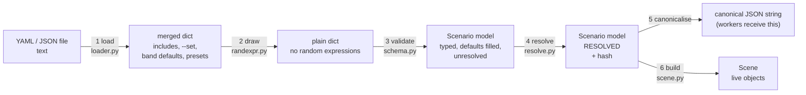

Errors on the way: stage 1 raises `ConfigError` (bad include, unknown preset, bad `--set` path), stage 2 `ConfigError`
(bad expression; also a plugin that is missing, fails to import, declares an incompatible API or clashes with another name), stage 3 pydantic `ValidationError` (typo, wrong type, impossible combination), stage 4 `ConfigError`
or `ValueError` (unknown NORAD, synthetic pass cannot converge, unknown calibration). `cli._resolve` catches all of them,
prints `error: ...` and exits with code 2.

The entry point is a single call chain: `cli._resolve(scenario, sets, plugins)` -> `config.resolve.resolve(path, sets, extra_plugins=...)` ->
`resolve_document(load_scenario(path, sets), base=cwd, now=None, scenario_dir)`. `--plugin` values are appended to the document's `plugins:` list first, so they end up in the resolved scenario like any other.

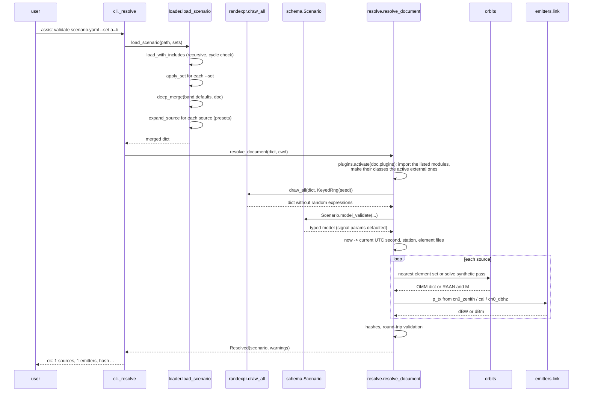

### 5.1 Stage 1: loading (`config/loader.py`)

`load_scenario(path, sets)` does four things in this order:

1. **Read with includes** (`load_with_includes`).
2. **Apply `--set` overrides** (`apply_set`).
3. **Lay the band's defaults underneath** (`deep_merge(band["defaults"], doc)`).
4. **Expand each source's preset** (`expand_source`).

#### 5.1.1 Reading YAML

PyYAML implements YAML 1.1, in which `137.0e6` and `1e6` parse as *strings*. The loader subclasses `SafeLoader` and
registers a YAML 1.2 float resolver so that `137.9e6` is a number. It also **removes the timestamp resolver**: ISO times
stay strings (`"2026-11-04T12:00:00Z"`) and are parsed later, always with an explicit zone. `.json` files go through
`json.loads`. The top level must be a mapping.

#### 5.1.2 Includes

`include:` is a path or a list of paths. Each is looked up **relative to the including file first, then relative to the
package directory** (`src/assist/`), which is how `bands/vhf137/terrestrial_default.yaml` resolves from anywhere. Includes
are loaded recursively with a stack of visited files (an include cycle is an error). They are merged left to right
into an empty document, and then **the including file is merged on top**: includes are always *underneath*.

#### 5.1.3 The merge rules (`deep_merge`)

`deep_merge(base, over)` never mutates its inputs. The rules, in the order the code applies them:

| Case | Result |
|---|---|
| Both are dicts and a *discriminator* key (`type`, `dist`, `kind`) exists in both with different values | `over` replaces `base` entirely. (Changing `schedule.type` from `on_off` to `continuous` must not inherit `on_s`.) |
| Both are dicts, and `over` gives one member of an *exclusive group* | The other members of that group are removed from `base` first. Groups: `{p_tx_dbw, cn0_zenith_dbhz, cal, cn0_dbhz, rx_dbm}`, `{norad, kepler, synthetic_pass}`, `{freq_hz, channel}`. (`level: {cal: x}` replaces a preset's `cn0_zenith_dbhz`.) |
| Both are dicts | Merge key by key, recursively. |
| Both are non-empty lists of dicts that all have an `id` | `merge_by_id`: entries with an existing id are deep-merged, new ids are appended. |
| Anything else (lists, scalars, `None`) | `over` replaces. So `am: null` really does delete a preset's AM. |

Example. The included environment defines a source `carrier-138`. This scenario switches it off without restating it:

```yaml
include: [bands/vhf137/terrestrial_default.yaml]
sources:
  - {id: carrier-138, carrier: {enabled: false}}
```

Both `sources` lists consist of dicts with ids, so they are merged by id; the entry `carrier-138` gains a key `carrier`.
Stage 1.4 will see that `carrier` is the id of one of the preset's emitters and route `{enabled: false}` to it.

#### 5.1.4 `--set path=value`

`parse_path("sources[z1].freq_hz")` gives `["sources", ("z1",), "freq_hz"]`: plain keys, and list selectors as
1-tuples. A selector matches a list item by its `id` (as a string), or by index if numeric. The value is parsed as YAML
(`137.35e6`, `true`, `[S-5, S-8]`) and **assigned, not merged**: `--set 'sources[z1].schedule={type: continuous}'`
replaces the whole `schedule`. Missing intermediate *dict* keys are created, missing list items are an error.

Order matters: `--set` runs **after includes but before band defaults and presets**. So it addresses the document *as
the user wrote it*: `sources[voice].voice.enabled=false` means "on source `voice`, set key `voice` (the emitter id) ..."
and only becomes `emitters[voice].enabled` in stage 1.4.

#### 5.1.5 Band defaults

`bands/<band>/band.yaml` has a `defaults:` block (the `frontend` and `antenna` defaults); `doc = deep_merge(defaults, doc)`
puts it *under* the scenario so you only write what you change. The band is chosen by `doc["band"]` (default `vhf137`).

#### 5.1.6 Preset expansion (`expand_source`)

A source with `preset: zombie` starts from `presets/zombie.yaml`: a partial source (`platform`, `emitters`, maybe `channels`).
Then every key the user gave on the source is routed by the **first matching rule**:

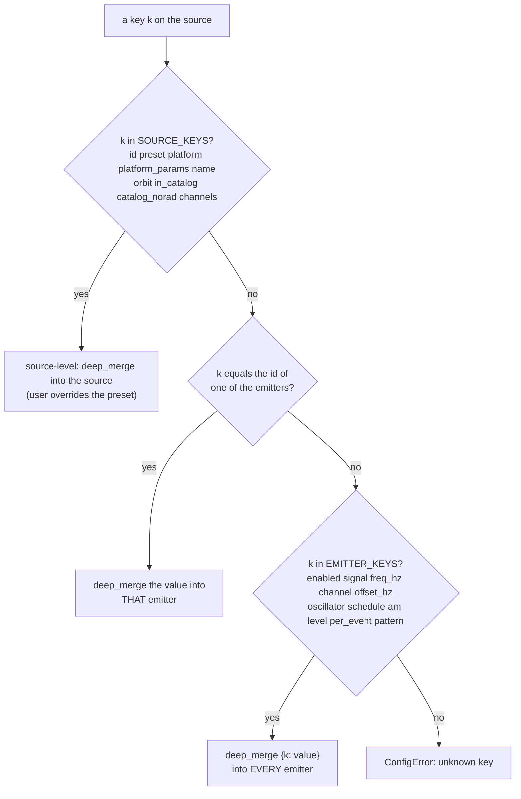

* A source's own `emitters:` list (must have ids) is merged by id **into** the preset's emitters, so you can add an emitter to a preset.
* A key matching an emitter's id (rule 2) lets you write `gateway: {enabled: true}` or `comb: {schedule: {rate_per_hour: 6}}`.
* An emitter field on the source (rule 3) goes to *all* emitters - perfect for single-emitter presets: `{id: z1, preset: zombie, freq_hz: 136.5e6, am: null}`.

Worked example. The scenario source

```yaml
- id: z1
  preset: zombie
  orbit: {synthetic_pass: {aos: +1min, max_el_deg: 45}}
  freq_hz: 137.35e6
  schedule: {on_s: 80}
```

expands to

```yaml
id: z1
preset: zombie
platform: satellite                      # from the preset
orbit: {synthetic_pass: {...}}           # rule 1
emitters:
  - id: carrier                          # from the preset
    signal: {kind: cw}
    oscillator: {pass_offset_sigma_hz: 50, drift_hz_s: 0.2}
    schedule: {type: on_off, on_s: 80, off_s: 180, ramp_ms: 5}   # on_s replaced, rest merged (rule 3)
    am: {period_s: 7.5, depth_db: 6}
    level: {cn0_zenith_dbhz: 45}
    pattern: qfh_poly
    freq_hz: 137.35e6                    # added by rule 3
```

Note that the **result still contains unexpanded strings** such as `pattern: qfh_poly` (turned into a polynomial by the
schema) and, for `orbcomm`, `channels: "sample([S-1, ...], 2)"` and `enabled: "bernoulli(0.5)"` (turned into values by stage 2).

### 5.2 Stage 2: random expressions (`config/randexpr.py`)

Any *string value* shaped like `name(args)` with name in `uniform | normal | randint | choice | sample | bernoulli` is a
random expression. `draw_all(doc, rng)` walks the whole document and replaces each by one draw:

| Expression | Draw |
|---|---|
| `uniform(a, b)` | `Generator.uniform(a, b)` |
| `normal(mu, sigma)` | `Generator.normal` (sigma >= 0) |
| `randint(a, b)` | `Generator.integers(a, b, endpoint=True)` - inclusive |
| `choice([x, y])` | one item (`integers(len)`) |
| `sample([x, ...], k)` | `k` distinct items in draw order (`choice(..., replace=False)`) |
| `bernoulli(p)` | `random() < p` |

The arguments are parsed by YAML (`parse_yaml("[" + args + "]")`), so lists and `137.9e6` work.

**The generator for each draw is `rng.stream("resolve", source_id, field_path)`.** `field_path` is the path inside the source with
list items named by id: `emitters[carrier].freq_hz`, `channels`, `emitters[gateway].enabled`. Fields outside `sources` use
`source_id = ""` and a path such as `station.lat`. That is Rule 2 in action: the ORBCOMM channel pair of `orbcomm-fm108`
depends only on `(seed, "orbcomm-fm108", "channels")`. It is the same however many other sources you add, and it
changes when you rename the source or change the seed.

One draw per field - a string is drawn **once, at resolve time** - so `freq_hz: "uniform(136.1e6, 136.9e6)"` is a *fixed* frequency for
the whole run, not a frequency that wanders.

### 5.3 Stage 3: validation (`config/schema.py`)

`Scenario.model_validate(...)` turns the plain dict into pydantic models. All models inherit `extra="forbid"`.
The top-level structure:

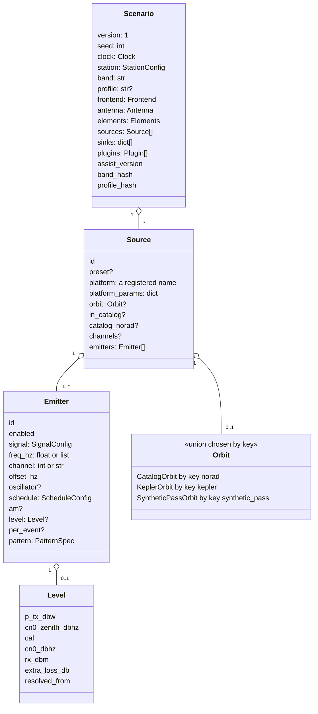

Things the schema does beyond types (these are the rules you hit as error messages):

* **Discriminated unions.** `orbit` is chosen by which key it has (`_orbit_tag`: `norad` | `kepler` | `synthetic_pass`), `schedule` by `type`, `pattern` by `type` (with the string aliases `qfh_poly` and `isotropic` expanded first by `_pattern_alias`).
* **`SignalConfig`**: `kind` must be a known kind (`get_kind`), and `check_params` validates the kind's parameter model and **writes back the defaults**, so a resolved scenario lists every parameter. A kind is known when it is a core kind or comes from a module the scenario lists under `plugins:` (those are loaded before validation).
* **`Level._one`**: exactly one of the five level keys. (A resolved level holds exactly `p_tx_dbw` or `rx_dbm`, plus `resolved_from`.)
* **`Emitter._frequency`**: exactly one of `freq_hz`/`channel`; a frequency *list* only for event signals; `level` required except for wideband kinds; wideband kinds forbid `level`, `per_event`, `am` and need an event schedule (episodes); `per_event` needs an event schedule.
* **`Source`**: `platform` must be a registered platform (`platform_class`), and `platform_params` is validated by that platform's `Params` model, with the defaults written back. The rules about what the source may have are read from the platform's **capabilities** (`_unique_emitters`): `needs_orbit` -> an `orbit` is required, otherwise forbidden; without `catalog` no `in_catalog`/`catalog_norad`; `oscillator` only with `supports_oscillator`; wideband kinds only with `allows_wideband`. For the three core platforms that reads: satellites need an orbit; ground/local forbid orbit, catalog flags and `oscillator`; wideband kinds only on `local`. Also: unique emitter ids; integer `channel` indices within `channels`.
* **`Plugin`**: one `plugins:` entry (a bare string is a `name`); exactly one of `name`, `path`, `module`, plus optional `prefix`, `only`, and the fields resolve fills in (`sha256`, `version`, `api`).
* **`Frontend`**: `ppm` must be 0 ("only 0 is supported"), `fs_hz` a positive integer multiple of 100 Hz (so a hop is a whole number of samples).
* **`Clock`**: `start` is `now` or an ISO time with zone (normalised to `YYYY-MM-DDTHH:MM:SSZ`), `duration` accepts `90s`, `10min`, `2h`, `1d`.
* **`Elements`**: `latest` and `latest_existing` are mutually exclusive.
* **`Scenario._unique_sources`**: duplicate source ids are an error.

`sinks` is a list of one-key mappings {sink name: settings}; `check_sinks` (`sinks/base.py`) looks each sink up in the registry and validates its settings
with the sink's own `Params` model (the `fft` sink reuses `FftSpec.from_dict`), writing the defaults back.

### 5.4 Stage 4: resolve (`config/resolve.py`)

`resolve_document(doc, base, now)` is the longest function in the config package, and the most important one: it freezes
everything that is not a pure function of the file's text. In order:

#### 5.4.1 Plugins, seed and validation
`plugins.activate(doc["plugins"], (base, scenario_dir))` runs **first**: the schema can only check `signal.kind`, `platform` and `sinks` once the external classes are registered. It returns the entries normalised and stamped with `api`, `version` and (for a file) `sha256`, and those replace the document's list ([18.2](#182-loading-plugins-pluginspy)). A document without a `plugins` key deactivates any plugin left from an earlier scenario in the same process.

`seed` must be a non-negative `int` (`bool` rejected). Then `draw_all` and `Scenario.model_validate`.

#### 5.4.2 `clock.start: now`
Becomes `format_iso(floor(time.time()))` - the current UTC second. This is the *only* use of the wall clock in the whole config path.
(The `now` argument exists so tests can inject a time.)

#### 5.4.3 Station (`_station`)
Priority: an explicit `station.file`; else, if `lat` or `lon` was given, the config values; else the default file
`samples/station.yaml` **if it exists**; else the rounded fallback 55.5 N, 37.1 E, 172 m. A station file supplies lat, lon, altitude and
optionally `tz`; an explicit `tz` in the scenario wins. `station.source` records where the position came from (`config`,
`fallback`, or the file path), which is part of the resolved (and hashed) scenario. *Consequence:* the same scenario resolves
to a different hash on a machine that has `samples/station.yaml`; for reproducible runs put a `station:` block in the scenario.

#### 5.4.4 Element files (`_concrete_elements`)
`elements.latest: true` -> find today's (UTC) `active_<date>.csv` and `satnogs_<date>.csv` in `elements/`, **downloading the missing ones**
(the only place a resolve can touch the network; on failure it warns and uses the newest existing). `latest_existing: true` -> the newest
existing snapshot per feed, no network. Either way the resolved scenario *lists the concrete files* and sets both flags to `false`, so
re-resolving a resolved document never downloads again and the catalog tools read the same files.

#### 5.4.5 Per-source work

For every source (`for src in sc.sources`):

**Orbit (`_orbit`)**, only for platforms with `needs_orbit` (the core `satellite`):

| Orbit form | What resolve does |
|---|---|
| `norad` (catalog) | `ElementStore.load(files).nearest(norad, t)` picks the OMM element set whose epoch is nearest `orbit.epoch` or the clock start (ties -> newer). The **full OMM dict is embedded** in `orbit.omm`. A set more than 14 days older than the clock start adds a warning. Unknown NORAD -> `ConfigError`. |
| `kepler` | Kept as is (epoch, `alt_km` or `a_km`, `i_deg`, ...). |
| `synthetic_pass` | `aos` is parsed (ISO or `+2min` relative to the clock start); `direction` (`asc`/`desc`) and `side` (`east`/`west`) are drawn from `rng.stream("resolve", sid, "orbit.synthetic_pass.direction"/".side")` if absent; then `solve_pass` finds the orbit ([6.4](#64-synthetic-passes-solving-an-orbit-for-a-given-aos-and-elevation)) and stores `solution: {raan_deg, m_deg}`. |

**Catalog flags.** `in_catalog` defaults to `true` for catalog orbits and `false` otherwise. A synthetic object with `in_catalog: true` needs a
`catalog_norad`; if none is given, `synthetic_norad(id)` = `90000 + blake2b(id) mod 10000`. `_check_norads` rejects collisions.

**Channels (`_channels`).** Names from the band's `channels` table (`S-5` -> 137 460 000 Hz) become frequencies, rounded to 1 mHz.

**Emitters (`_emitter`)** - for each emitter:

* `channel` -> `freq_hz` (a name from the band, or an index into the source's resolved `channels`); `channel` is cleared.
* All frequencies are quantised to 1 mHz (`round(f * 1000) / 1000`); `offset_hz` too.
* `on_off` schedule without `phase_s`: drawn uniformly in `[0, on_s + off_s]` from `("resolve", sid, "emitters[id].schedule.phase_s")`, rounded to 1 ms.
* `am` without `phase_rad`: drawn uniformly in `[0, 2 pi)` from `("resolve", sid, "emitters[id].am.phase_rad")`.
* **Level**: see below.

**Level resolution (`_level` / `_fixed_level`).** Everything is turned into the one number the engine needs. The platform's `level_mode` decides which: `link_budget` (the core `satellite`) -> *transmit power in dBW*; `received` (ground, local and every external platform) -> *received power in dBm*. Link budget:

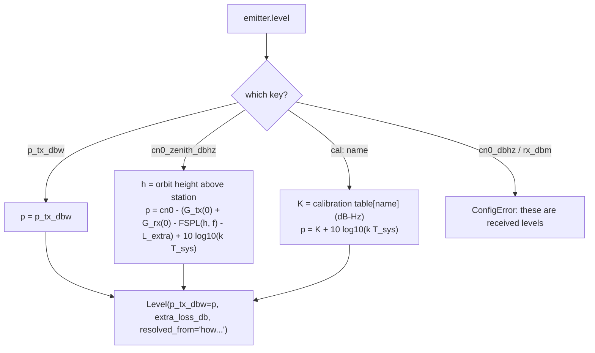

* **`cn0_zenith_dbhz`**: "my overhead pass should show this C/N0". Height `h` is the orbit's mean semi-major axis minus Earth radius minus station altitude
  (`satellite_height_m`; for a catalog orbit `a = (mu / n^2)^(1/3)` from the OMM mean motion). It solves
  `P_tx = C/N0 - [G_tx(0) + G_rx(0) - FSPL(h, f) - L_extra] + 10 log10(k T_sys)` using the emitter's *first* frequency.
* **`cal`**: calibrated *link constants* (see [6.7](#67-the-link-budget-and-calibrations)). `meteor_auto` becomes `meteor_m2_3` / `meteor_m2_4` if the source's NORAD id matches an entry with a `norad`, else the joint `meteor`.
  The table comes from the profile (`meteor_cal.json`, `orbcomm_ref.json`) when the scenario has `profile:`, else from `band.yaml`'s `calibrations`.
* Received levels (ground, local, external platforms): `cn0_dbhz` -> `rx_dbm = cn0 - extra_loss + 30 + 10 log10(k T_sys)` (the `+30` converts dBW to dBm); `rx_dbm` -> `rx_dbm - extra_loss`.

`resolved_from` records the arithmetic in words, e.g. `cn0_zenith_dbhz 45.0 at 819.8 km, T_sys 726.6 K`. That string is part of the resolved scenario.

`T_sys`, the system noise temperature referred to the antenna, comes from the scenario's `frontend` (formula in [6.7](#67-the-link-budget-and-calibrations)); with the band defaults it is **726.6 K**, so `k T_sys` = -199.99 dBW/Hz = -169.99 dBm/Hz.
Every C/N0 in the project is "dB-Hz against that noise density".

#### 5.4.6 Wrap-up

After all sources: `_check_norads`; the profile directory must exist; then the scenario is stamped with

* `assist_version`,
* `band_hash` = `dir_hash(bands/<band>)` (sha256 over relative paths + file hashes),
* `profile_hash` = `dir_hash(profile, exclude=("bank",))` (the local sample bank is excluded).

Finally the model is **round-tripped**: `Scenario.model_validate(json.loads(canonical_json(sc)))`. That makes the in-memory result *exactly* what
re-reading the JSON would give (floats normalised, defaults identical).

### 5.5 Stage 5: the canonical form and the hash

`canonical_json(sc)` = `json.dumps(doc, sort_keys=True, separators=(",", ":"), ensure_ascii=False)`, where `doc` is `sc.model_dump(mode="json")` with two things left out when empty: the `plugins` list, and a source's `platform_params`. A scenario that uses only core modules therefore has the same canonical form whether or not the plugin machinery exists.

The **scenario hash** (`Resolved.hash`) is the sha256 of the same JSON **with `sinks` emptied**: the hash names *what is rendered*, not where it goes, so `--set 'sinks[wav].rf64=true'` or adding a sink leaves it alone. Properties:

* **Idempotent.** A resolved document resolves to itself: `omm`, `solution`, `resolved_from`, a concrete clock start, a concrete element file list and
  `phase_s` are all present, so every "if missing, fill in" branch is skipped. That is why `assist resolve -o r.json` followed by `assist run r.json` is legal.
* **Complete.** The hash covers the seed, clock, station position, front end, antenna, band and profile content hashes, every source, orbit, element set, solved orbit, level and parameter.
  Same hash => same stream (to the bit with the same kernels; C++ and numpy builds differ by at most one count in a few per million samples).
* **Machine-independent.** The element data is embedded, the profile is hashed by content (not path), and the profile is named by its path *as written in the scenario*.
* **Plugins are covered.** Each `plugins:` entry carries the plugin's declared `api`, its `version` and, for a file, the `sha256` of its content: a changed plugin is a changed scenario. A resolved scenario refuses a plugin file whose content no longer matches.
* **What it does not cover:** ASSIST's own *code*, and the `sinks`. `run.json` records `assist_version`, the engine name, the API version and the sinks that ran next to the hash.

### 5.6 Stage 6: building the scene (`engine/scene.py`)

`Scene(resolved_scenario)` refuses an unresolved scenario (`clock.start == "now"` or `assist_version is None`). It first calls `plugins.activate` with the scenario's own list, so exactly that scenario's external classes are active while it is built and rendered (a worker process, or a second scenario in one process, starts from a clean state). Then, for each source, the platform class is looked up in the registry and built with `cls.build(PlatformContext(...))`: the source id and name, the validated `platform_params`, the station, `horizon_deg`, the scope `rng.scope("platform", platform, source_id)` and the resolved source itself (which the core `satellite` reads its `orbit` from).

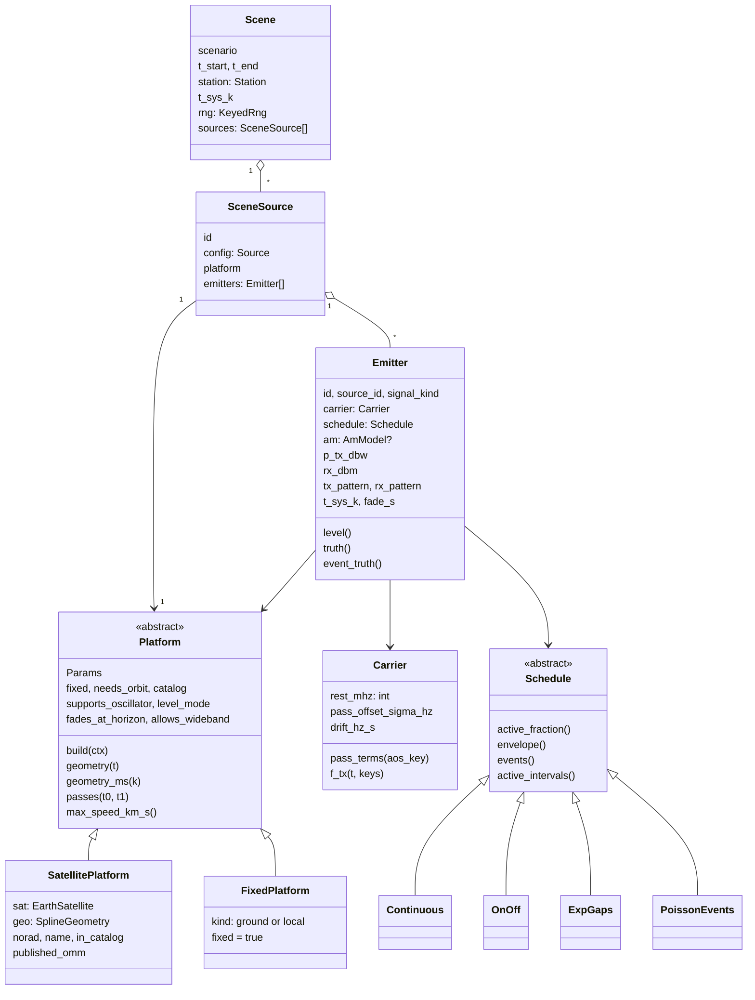

For each *enabled* emitter the scene builds:

* the emitter's **scope** `rng.scope(source_id, emitter_id)`, handed to the carrier and the schedule (the signal gets the same prefix later, as `Keys`);
* a **`Carrier`** with `rest_mhz = to_mhz(freq) + to_mhz(offset_hz)` - for an event emitter with several frequencies, a tuple of them (`freqs_mhz`), and the first is the carrier's rest;
* an **`AmModel`** if `am` is set;
* a **`Schedule`** via `make_schedule`, with an **`EventMaker`** from `make_maker` for event signals and emitters with `per_event`;
* the **`Emitter`** record itself, copying the resolved `p_tx_dbw` or `rx_dbm`, the transmit pattern, `extra_loss_db`, the shared receive pattern, `T_sys`, and `fade_s` (`station.fade_s` when the platform declares `fades_at_horizon`, as the satellite does; 0 otherwise).

**The event maker** is the interesting part. When an event schedule creates an event, the maker draws its duration and parameters from the *same keyed slot
stream*, in a fixed order:

1. the **channel index** if the emitter has several frequencies (`g.integers(len(freqs))`), recording `channel` and `freq_hz` in the event's params;
2. the **signal's own draw** `cls.draw_event(params, g)`: LoRa draws `sf` then `payload_bytes` and returns the airtime as duration; D8PSK draws a symbol count; GFSK a bit count; `am`/`noise_comb` return `None` (the schedule's duration distribution decides);
3. if the signal returned no duration: the schedule's `duration` distribution (`fixed` / `lognormal` / `exponential`, clipped at `max_s`);
4. the **per-event draws** if `per_event` is set: an `offset_hz` (uniform in the range, rounded to 1 mHz) and a `level_db` (normal clipped, or uniform).

A fixed draw order is what makes a slot's events reproducible. Changing the first draw (adding a second frequency) legitimately reshuffles that emitter's events - and *only* that emitter's.

---

## 6. Time, orbits, geometry and the link budget

### 6.1 The time base (`timebase.py`)

* `parse_iso("2026-11-04T12:00:00Z")` -> Unix seconds, exact to 1 microsecond; **a zone is mandatory** (a naive time raises).
* `format_iso(t, decimals)` -> `...Z` string (microseconds if there is a fraction, or a fixed number of decimals).
* `parse_duration("90s" | "10min" | "2h" | "1d" | "250ms" | 3600)`.
* `parse_time(s, ref)` -> an ISO time, `start` (= ref) or `+2min` / `-30s` relative to `ref`. This is what `--from`, `--to` and `aos:` use.
* `sample_at(t, fs)` -> nearest absolute sample index, **by integer microsecond arithmetic** (ties up).
* `unix_to_time(t)` -> a Skyfield `Time`. It deliberately *does not* use `ts.utc(1970, 1, 1, 0, 0, t)` (that applies the 1970 leap-second offset and is 27 s off in 2026): it
  splits into whole days plus seconds of day so Skyfield looks up the leap seconds for the right date. Skyfield's built-in tables are used; **no download**.
* `unix_to_time_fast(t)` swaps the IAU 2000A nutation series for the 8x cheaper IAU 2000B. Because station and satellite rotate with the same nutation, the station-to-satellite geometry changes by ~1e-8 m. The simulator uses the fast one; the profile tool the full one.

### 6.2 Element sets (`orbits/elements.py`)

* **Formats** (by extension): `.csv` OMM in the retlector.eu layout (header checked by name, so upstream column changes fail loudly), `.json` OMM, `.tle`/`.txt`/`.3le` (converted to OMM dicts by sgp4's exporter).
* **`ElementStore`** keeps *every* element set of *every* file, per NORAD id, sorted by epoch (the same object and epoch in two feeds: first wins). `nearest(norad, t)` is `min(|epoch - t|, tie: newer)`.
  The older profile-tool rule ("newest set per object") is `load_newest`.
* **Staleness**: `staleness_warning` fires only when the clock start is more than 14 days *after* the epoch. Future epochs never warn (predictive sets exist).
* **Fetching** (`fetch`): downloads `https://retlector.eu/active/csv` and `/satnogs/csv` into `<feed>_<UTC date>.csv`. Each file is written as `.part`, validated (OMM header present, every `NORAD_CAT_ID` an int, every `EPOCH` parseable) and then renamed. **An existing snapshot is never overwritten** (`FileExistsError`).
  This and `latest_snapshots` are the only code that reaches the network, and only when the user ran `fetch_omm` or set `elements.latest: true`.

### 6.3 The truth satellite (`platforms/satellite.py`)

`truth_satellite(src)` builds the SGP4 satellite the simulation actually uses, plus the NORAD id/name the *catalog* shows:

| Orbit | Truth satellite | Catalog entry |
|---|---|---|
| catalog `norad` | `EarthSatellite.from_omm` of the embedded OMM | the same OMM |
| catalog + `perturb` | the OMM with `perturb_omm(...)` applied | the **unperturbed** OMM (this is the point: the tracker is given a slightly wrong element set) |
| `kepler` | `kepler_satellite(Kepler(...))` | listed only if `in_catalog` |
| `synthetic_pass` | `kepler_satellite` from `(aos, a, e=0, i, raan, argp=0, M)` using the solved RAAN and M | listed only if `in_catalog`, under `catalog_norad` |

`perturb_omm`: `along_track_s > 0` puts the real satellite that many seconds *behind* the published one by moving the mean anomaly back by
`n * 360 deg/day / 86400 * along_track_s`; `raan_deg` and `inc_deg` are added; `dn_rev_day` is added to the mean motion, so the along-track error then *grows with time from the epoch*.

`kepler_satrec` initialises SGP4 directly with `Satrec.sgp4init(WGS72, "i", ...)` from mean elements: mean motion `n = sqrt(mu / a^3)` (rad/min), epoch in days since 1949-12-31.

### 6.4 Synthetic passes: solving an orbit for a given AOS and elevation

A scenario can say "a pass that rises at `+2min` and peaks at 45 degrees" without naming a satellite. `orbits/synthetic.solve_pass` finds a **circular** orbit (e = 0, argp = 0, default 820 km, 98.7 degrees) whose epoch is the requested AOS and whose RAAN and mean anomaly are chosen to fit.

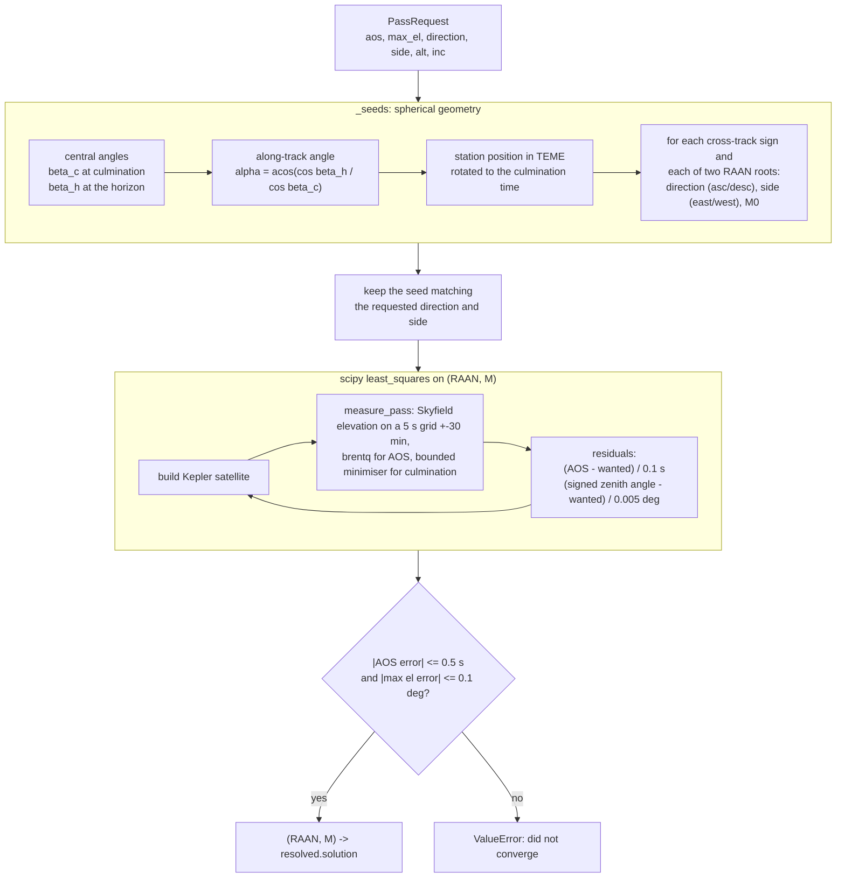

Two details: the elevation residual uses the **signed zenith angle** (positive on one side of the track, negative on the other), which is smooth through the zenith, unlike
`max_el`, so 90-degree passes converge. And the "horizon" used is `station.horizon_deg` (default 0), so `aos` means "crosses *that* elevation".
Afterwards the solved orbit is just a Kepler orbit stored in the scenario; nothing is solved at render time.

### 6.5 Geometry for the simulator: `SplineGeometry`

The renderer needs range, range rate, elevation, azimuth and off-nadir angle **1000 times per second per satellite** for hours. Calling Skyfield that often is too slow. So:

* Time is cut into **aligned one-hour blocks** (`BLOCK_S = 3600`, index `floor(t / 3600)`).
* For each block, Skyfield evaluates the geometry at **every whole Unix second** from `-120 s` to `+3720 s` of the block (3841 samples; a 2-minute margin on each side so splines are valid at the edges).
* **Cubic splines** are fitted to range, elevation, unwrapped azimuth and off-nadir angle.
  **Range rate is the derivative of the range spline**, not Skyfield's velocity, so range and range rate are always consistent (the integral of Doppler matches the range phase).
* The block grid does not depend on what was asked for, so **any window gives the same values** (random access). Up to 8 blocks are kept (LRU).
* `geometry_ms(k_ms)` takes *integer Unix milliseconds* and forms the time inside the block as `(k - block*3_600_000)/1000` from integers, exact to ~1e-13 s. (Float Unix seconds resolve only ~0.24 us, a range error up to ~2 mm, i.e. a few mrad of phase at 137 MHz.)

`off_nadir_deg` is the angle at the satellite between the geocentric nadir and the direction to the station, computed from `r_sat` and the station-to-satellite vector `d` as `atan2(|r x d|, r . d)`. It is the argument of the **transmit** antenna pattern; `90 - elevation` is the argument of the **receive** pattern.

### 6.6 Passes and pass keys

Each block records its **horizon crossings**: between consecutive whole seconds where `el >= horizon` flips, `brentq` on the spline refines the crossing time (to 1 ns), and the crossing remembers `key` = the first whole second on the new side.

`SplineGeometry.passes(t0, t1)` returns **complete passes** (true AOS and LOS, never clipped to the window) overlapping `[t0, t1)`:

1. crossings inside the window;
2. if the window starts mid-pass, `_last_before(t0)` looks back up to `LOOK_BLOCKS = 24` hours for the rising crossing; if the window ends mid-pass, `_first_after` looks forward for the setting one;
3. pair them (rise, set); `_culmination` takes the best whole second and refines it with a bounded minimiser (searching relative to the lower bound, because bounded Brent's tolerance is *relative to |x|*, which is 27 s at Unix 1.8e9);
4. `Pass(norad, name, aos, tca, los, max_el_deg, aos_key)`.

**`aos_key`** (the first whole second at or above the horizon) identifies a pass **independently of the window that found it**. It is the integer in the RNG key `(source, emitter, "pass", aos_key)` that draws a zombie's per-pass frequency offset and drift sign, so the same pass always gets the same oscillator, however you slice time. It also anchors the drift term `drift * (t - aos_key)`.

The engine asks for passes **per UTC hour** and caches them (`EmitterRender._hour_passes`), see [9.8](#98-caches-prefetch-and-speed).

### 6.7 The link budget and calibrations

```
P_rx [dBm]   = P_tx [dBW] + 30 + G_tx(off-nadir) - FSPL(R, f) + G_rx(90 deg - el) - L_horizon - L_extra
C/N0 [dB-Hz] = P_rx [dBm] - 30 - 10 log10(k T_sys)
FSPL [dB]    = 20 log10(4 pi R f / c)
```

* **Antenna patterns** (`link.Pattern`): `poly` - dBi as a polynomial in degrees off boresight, clamped outside `0..max_deg` to the `max_deg` value;
  `cardioid` - `peak + 10 n log10((1 + cos x) / 2)` floored 60 dB below the peak; `isotropic`. The default `qfh_poly` is a quadrifilar-helix fit:
  `G(x) = 3.3691 + 0.019754 x - 7.5735e-4 x^2 - 3.6246e-6 x^3` dBi - 3.37 dBi at 0 deg, 3.18 at 30, 1.05 at 60, **-3.63 at 90 deg**.
  Both ends use it by default: the satellite transmit pattern is also `qfh_poly`.
* **`L_horizon`** is `HorizonModel.loss_db`, which is **identically zero**: there is no terrain model. The 15 s fade ([7.5](#75-fade-the-horizon-replacement)) replaces it.
* **System temperature** (`link.t_sys_k`):

  `T_sys = T_ant + (L_saw - 1) 290 + L_saw T_lna + L_saw T_tuner / G_lna` with `T_x = 290 (10^(NF/10) - 1)`.

  | Term | Value (band defaults) | K |
  |---|---|---|
  | antenna | `t_ant_k` = 500 | 500.0 |
  | SAW loss 1.465 dB (`L = 1.4012`) | `(L - 1) * 290` | 116.3 |
  | LNA NF 1.0 dB | `L * 75.1` | 105.2 |
  | tuner NF 3.5 dB, behind a 20 dB LNA | `L * 359.3 / 100` | 5.0 |
  | **total** | | **726.6** |

  `k T_sys` = 1.003e-20 W/Hz = -199.99 dBW/Hz = **-169.99 dBm/Hz**.

* **Calibrations as link constants.** A calibration stores `K` = "the C/N0 the link would give at 0 dB total path gain" (`G_tx + G_rx - FSPL - losses = 0`).
  `K` does not depend on `T_sys`, so a calibrated SNR stays right whatever `t_ant_k` you assume: `P_tx = K + 10 log10(k T_sys)`.
  METEOR calibrations come from `meteor_cal.json`: a fitted in-band SNR constant `C` (in 100 kHz) is converted by `K = C + 10 log10(100 kHz) - 10 log10(band_power_fraction)`
  (fraction 0.9947: the LRPT spectrum partly outside 137.9 +- 50 kHz). Results: **M2-3 197.76, M2-4 199.76, joint 198.80 dB-Hz** (these also appear in `band.yaml`, and a test checks they match). ORBCOMM: 191.60 dB-Hz
  (the mean of the two channels' medians, FM117 during one low pass).

A worked number, measured from the code (a METEOR on a 60-degree pass at TCA): elevation 60.0 deg, range 939.4 km, off-nadir angle 26.2 deg.
`FSPL(939.4 km, 137.9 MHz) = 134.70 dB`, `G_tx(26.2 deg) = +3.30 dBi`, `G_rx(90 - 60 = 30 deg) = +3.18 dBi`. The calibration `K = 198.80 dB-Hz` gives
`P_tx = 198.80 - 199.99 = -1.19 dBW`, so `P_rx = -1.19 + 30 + 3.30 - 134.70 + 3.18 = -99.40 dBm` and `C/N0 = -99.40 - 30 + 199.99 = 70.58 dB-Hz`. That is an in-band SNR of
about 20 dB in 100 kHz, and in the IQ stream an amplitude of **87.9 ADC counts** (RMS noise per component: 26.7) - see [section 16](#16-a-worked-example-end-to-end).

---

## 7. The emitter model: carrier, schedule, modulation, fade

An **emitter**'s samples are the product of independent factors. Where each factor comes from:

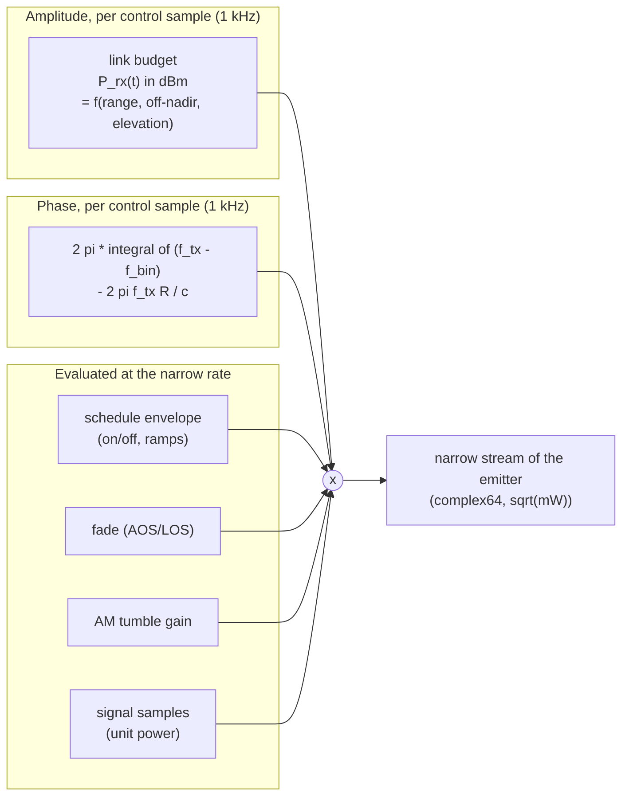

### 7.1 The carrier model (`emitters/carrier.py`)

```
f_tx(t) = f_nominal + offset_hz + pass_offset(p) + drift(p) * (t - t_aos(p))
```

* `f_nominal + offset_hz` is the **rest frequency** (`Carrier.rest_mhz`, integer millihertz).
* `pass_offset(p)` and `drift(p)` exist only for emitters with an `oscillator:` (zombies). For pass `p` with key `aos_key`, they are drawn from the stream
  `(source_id, emitter_id, "pass", aos_key)`: **first** `normal(0, pass_offset_sigma_hz)` (quantised to mHz), **then** the drift sign (`random() < 0.5` -> negative), times `drift_hz_s`.
  Cached per pass in the `Carrier`.
* `t_aos(p)` is the pass key (a whole second), so the drift term `drift * (t - aos_key)` is a small float on top of an exact integer base.
* Outside any pass, `f_tx` is the rest frequency (the key is -1).

`Carrier.f_tx(t, keys)` returns `(base in integer mHz, small drift part in Hz)` so that `f_tx = base/1000 + small`. The truth code uses this; the engine uses the same pieces
inside the phase computation ([9.4](#94-control-samples-amplitude-and-carrier-phase)).

**Doppler.** The received frequency is `f_rx = f_tx + doppler` with `doppler = -f_tx * range_rate / c` (first order). In the IQ stream Doppler is not applied as a frequency shift at all: it is **the time derivative of the range phase `-2 pi f_tx R(t)/c`**, so the instantaneous frequency of the rendered carrier is
automatically `f_tx - f_tx * dR/dt / c` (plus a tiny `-drift * R/c` term, ~1 mHz at the worst case). Truth and IQ therefore agree by construction (checked in `test_orbits` and `test_render`).

### 7.2 Schedules (`emitters/schedules.py`)

All schedules are functions of **absolute Unix time**. Four methods are the interface:

| Method | Meaning |
|---|---|
| `envelope(t)` | Amplitude 0..1 at times `t`, including ramps. |
| `active_fraction(t, step)` | Share of `[t, t+step)` during which the emitter is on (half-amplitude edges, no ramps). Used by `truth`. |
| `active_intervals(t0, t1)` | Intervals outside which the envelope is *exactly* zero. Lets the engine skip silent blocks. |
| `events(t0, t1)` | Event schedules only: the bursts overlapping the window. |

#### `continuous`
Envelope 1, active fraction 1, one interval `[t0, t1]`.

#### `on_off`
On for `on_s` out of every `period = on_s + off_s`, an on-interval starting at `phase_s` (mod period).

* `envelope`: `u = mod(t - phase_s + r/2, period)` with `r = ramp_ms/1000`; the rising ramp is `0.5 (1 - cos(pi u / r))` for `u < r`, the plateau is 1 until `on_s`,
  the falling ramp is `0.5 (1 + cos(pi (u - on_s) / r))` for `on_s <= u < on_s + r`. The ramps are **centred on the edges**, so the *on interval is measured between half-amplitude points*
  (at `t = phase_s` the envelope is exactly 0.5).
* `active_fraction`: `(on_time_until(t + step) - on_time_until(t)) / step`, with `on_time_until(x) = k * on_s + min(u, on_s)`; exact for any step.
* `active_intervals`: the on-intervals widened by `ramp/2` on each side.

#### Event schedules: `exp_gaps` and `poisson_events`
Both derive from `_EventSchedule`, which has the machinery:

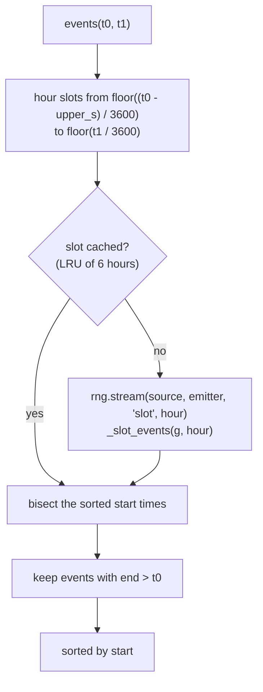

* A **slot** is one UTC hour (`SLOT_S = 3600`, index `floor(t/3600)`). Its events are generated **entirely from the keyed stream
  `(source_id, emitter_id, "slot", hour_index)`**, so any hour can be generated alone, in any order, on any machine.
* `upper_s` is the longest possible event. Looking back `upper_s` before `t0` catches events that began in the previous hour and are still running.
* The slot cache holds 6 hours because a busy VDL station has ~9000 events per hour.

**`exp_gaps`.** In each slot, a fresh chain: `t = slot_start + gap`, then repeatedly: draw an event at `t`; `t = event.end + gap`; stop when `t >= slot_end`.
`gap = min_gap_s + Exponential(mean_gap_s - min_gap_s)` (so the mean gap is `mean_gap_s`). Because every slot restarts, slots are independent - at the price that the
first event in each hour is at `min_gap + Exp` after the hour boundary. **Constraint:** `upper_s <= min_gap_s` (an event can never run into the next slot's first event); violated -> `ValueError` when the scene is built (so `passes` also reports it).

**`poisson_events`.** In each slot: `N ~ Poisson(rate)` where `rate` is `rate_per_hour` or (if a list of 24) `rate_per_hour[slot % 24]` - `slot % 24` *is* the UTC hour of day because the Unix epoch starts at UTC midnight.
Start times: `N` uniform draws on `[0, 3600)`, sorted. Then durations/parameters per event (from the maker, or all durations at once from the duration distribution).
**`min_gap_s > 0` models one transmitter**: after everything is drawn, an event is dropped if it starts less than `min_gap_s` after the end of the previous *kept* event. The kept rate is then
`rate / (1 + rate * (duration + min_gap))`; `profile.terrestrial.dead_time_rate` inverts that to hit a measured rate. With `min_gap_s = 0` events are independent and **may overlap** (two aircraft on one channel add and beat).

**Duration distributions** (`DurationDist`): `fixed(s)`, `lognormal(median_s, sigma)` = `exp(Normal(ln median, sigma))`, `exponential(mean_s)`, all clipped at `max_s`.

**Event envelopes** (`event_envelope`). For a *continuous* signal gated by an event schedule with `ramp_ms = r > 0`:

```
u = clip((t - (start - r/2)) / r, 0, 1)        d = clip(((end + r/2) - t) / r, 0, 1)
envelope = 0.5 (1 - cos pi u) * 0.5 (1 - cos pi d)
```

Again centred on the edges (0.5 at `start` and at `end`); `r` is shortened to the event length if the event is shorter. Event *signals* (`lora`, `d8psk`, ...) shape their own bursts and the schedule envelope is not applied to them.

`active_fraction` for event schedules sums each event's overlap with the step, so it can exceed 1 where events overlap.

### 7.3 The AM tumble (`AmModel`)

A spinning dead satellite modulates its carrier through its antenna pattern. Modelled as

```
gain_dB(t) = -(depth_db / 2) * (1 - cos(2 pi * frac(t / period_s) + phase_rad))
```

in `[-depth_db, 0]`. `t` is absolute Unix seconds; the reduction `fmod(t, period) / period` is done *first, exactly*, so the phase is right at Unix time 1.8e9. `phase_rad` is a keyed draw at resolve time.
The gain is added to `rx_dbm` in truth and applied (as an amplitude factor `10^(gain_dB/20)`) to the envelope in the IQ.

### 7.4 What "active" means for a satellite emitter

A satellite emitter can be non-zero only where **all** of these hold: the satellite is in a pass (`visible`), the schedule is on (or inside an event), and the signal's own gating allows it.
The engine intersects them as interval lists (`_intersect(visible, schedule intervals)`) per chunk; blocks (10 ms) that do not touch the intersection are flagged inactive and **skipped by the synthesiser entirely**. This is the main reason a mostly-quiet sky is cheap.

### 7.5 Fade: the horizon replacement

There is no terrain/horizon model (`HorizonModel.loss_db` is zero). Instead, a satellite signal **rises from nothing to its link-budget amplitude over `station.fade_s` (15 s) after AOS and falls back to nothing over the same time before LOS**:

```
x   = min( min(t - AOS, LOS - t) / fade_s , 1 )
gain = 0.5 - 0.5 cos(pi x)           (an amplitude gain, 0 outside the pass)
```

At 7.5 s into the fade the amplitude is 0.5 (-6 dB). A pass shorter than `2 * fade_s` never reaches full level. `fade_s: 0` switches it off. It applies to platforms that declare `fades_at_horizon` (the satellite); `Emitter.fade_s = 0` for all others.
The noise is untouched, so a signal fades *into noise*, like a real one dropping below the horizon. **The fade is applied in the IQ but not in `truth`**: truth rows are present for the whole above-horizon pass with full link-budget levels.

### 7.6 Ground and local emitters

They have no geometry. In the code they are `FixedPlatform`s with the capability `fixed = True` (`local` adds `allows_wideband`). The columns below are the capabilities of `platforms/base.py` spelled out for the three core platforms; a platform from a plugin picks its own combination, within the limits in [18.4](#184-platforms-by-capability):

| | satellite | ground | local |
|---|---|---|---|
| `fixed` | no | yes | yes |
| orbit, passes, Doppler | yes | no | no |
| level | `p_tx_dbw`, then the link budget at each instant | fixed `rx_dbm` | fixed `rx_dbm` |
| antenna patterns | tx and rx | none (level is at the antenna terminals) | none |
| `oscillator` | allowed | forbidden | forbidden |
| `fade_s` | yes | 0 | 0 |
| truth geometry columns | filled | empty | empty |
| goes through the receiver response `H_rx` | yes | yes | `cw`/`noise_band`: yes; `noise_comb`: no ([17](#17-limits-caveats-and-known-discrepancies)) |

Aircraft are **not platforms**: an aircraft VDL burst is a ground event whose `per_event` draw gives each burst its own frequency offset (and so its own "Doppler") and its own level.

When an emitter has `per_event` or is a fixed event emitter, the engine renders **each event separately** ([9.5](#95-from-control-samples-to-a-narrow-stream)), which is how two overlapping bursts on one frequency add and beat.

---

## 8. Signal kinds, one by one

### 8.1 The contract (`signals/base.py`)

Every modulation is a subclass of `Signal`, registered under its kind name with `@register_signal("name")` (the decorator checks `Params` and `mode` and sets `cls.kind`). It receives validated parameters (`Params`, a pydantic model with `extra="forbid"` whose defaults are written into the resolved scenario), a `Keys` object, and the kernel module `dsp`.

`Keys` is the emitter's `RngScope`, prefix `(source_id, emitter_id)`: `keys.key64(*purpose)` gives a 64-bit Philox key, `keys.stream(*parts)` a numpy Generator. The signal holds neither the seed nor the `KeyedRng`. `make_signal` hands a core kind exactly this scope (so the keys are those the kinds have always used), and a kind from a plugin the same emitter's keys under the namespace `("signal", kind)`.

Three **modes**:

| Mode | Interface | Kinds |
|---|---|---|
| `continuous` | `render(n0, n, rate)`: `n` complex64 samples at `rate`, starting at absolute narrow index `n0` (time `n0 / rate`) | `cw`, `oqpsk`, `oqpsk_burst`, `sdpsk`, `noise_band` |
| `event` | `draw_event(params, g)` -> `(duration, params)`; `max_duration_s`; `render_events(events, n0, n, rate)`; `event_bounds(ev)` | `lora`, `d8psk`, `gfsk`, `am` |
| `wideband` | `render_wide(events, h0, nhops, hop, fs, n0_w, f_offset_hz)`: rendered at the full rate, added before the ADC | `noise_comb` |

Output convention: **unit mean power while on** (`|x|^2` averages to 1). The emitter's level (as an amplitude in sqrt(mW)) is applied by the engine's NCO, not by the signal. Exceptions: ramps (power falls), `am` (the *carrier* has unit power; the voice sidebands add a few percent).

Three methods tell the engine what sample rate the signal needs ([9.2](#92-the-narrow-rate-and-the-coarse-bin)):

| Method | Meaning |
|---|---|
| `bandwidth_hz()` | Occupied bandwidth of the baseband signal. |
| `preferred_rate()` | The lowest narrow rate the signal likes (e.g. `sps * rs`). |
| `rate_step()` | The narrow rate must be a multiple of this (e.g. the symbol rate, so samples per symbol is an integer). |

`cw` has the attribute `constant = True` (all samples are 1), so the engine does not even call `render`.

**Random content.** All payloads come from `dsp.random_bytes(key, counter, n)` (Philox4x32-10, counter `(i, 0, counter_lo, counter_hi)`; each call yields 16 bytes). The *key* is `keys.key64(purpose)`; the *counter* is an absolute index. That is what lets any window of a 72 ksym/s stream be generated from nothing.

### 8.2 `cw` - unmodulated carrier

Samples are all 1; bandwidth 0; preferred rate 100 Hz. Everything interesting (frequency, Doppler, AM, on/off keying) comes from the emitter. A `cw` zombie is rendered at a narrow rate of only ~11 kHz (set by the Doppler excursion bound), so it costs almost nothing.

### 8.3 Pulse-shaped linear modulations (shared code, `signals/pulse.py`)

`oqpsk`, `oqpsk_burst` and `sdpsk` share `ShapedSignal`:

* Symbol `k` sits at Unix time `k / rs` (an **absolute symbol grid**); narrow sample `n` at `n / rate` with `rate = sps * rs`.
* **Root-raised-cosine taps** (`rrc_taps(alpha, sps, span)`): `span * sps + 1` taps, centred, closed-form with the `x = 0` and `x = 1/(4 alpha)` special cases, scaled so `sum(h^2) = sps`. With unit-power symbols that gives unit mean output power.
  (`span = 10` symbols: 41 taps at `sps = 4`.)
* `symbol_range(n0, n, sps)` gives `[k_lo, k_hi)` = every symbol with a tap on the requested samples (`c = span*sps//2`, extra `sps//2` for the delayed Q branch).
* `dsp.shape(si, sq, k_lo, taps, sps, qd, n0, n)` is a **polyphase filter**: output sample `m` = `sum_k s[k] h[m - k*sps + c]`, computed in double. The Q branch is evaluated at `m - qd` (`qd = sps//2` for OQPSK: Q is half a symbol late; 0 otherwise). Sample positions never depend on where the window starts.

Because a symbol only affects the `span*sps` samples around it, a requested window needs the symbols just before and after it - generated from their absolute indices.

### 8.4 `oqpsk` - METEOR-M LRPT

72 000 sym/s OQPSK, RRC alpha 0.6, 4 samples per symbol (narrow rate >= 288 kHz). Framing `meteor_cadu` builds a **CADU** (1024 bytes) per frame; frame `f` holds symbols `[8192 f, 8192 (f+1))` = 113.78 ms:

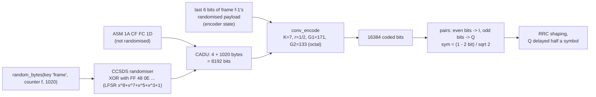

* The encoder needs only the 6 bits preceding the frame, i.e. the end of frame `f-1`'s payload, so **frame `f` is encoded on its own** (generating `payload(f-1)` costs one extra `random_bytes` call).
* Payload is random (no Reed-Solomon, no real instrument data): spectrum and symbol level are right, but the stream is **not decodable**. `framing: random` skips the CADU structure (random symbols, 4096 per keyed block).
* Caches hold the last 24 frames (a 1 s chunk spans ~9) and the matching payloads.

### 8.5 `oqpsk_burst` - ORBCOMM gateway downlink

OQPSK at 28 800 sym/s in **segments** that start every `period_s` = 0.95 s (27 360 symbols). Segment `s` (absolute) holds 4 or 5 blocks (`n_blocks(s)` = 4 + `random_bytes(key 'segment', s, 1)[0] mod 2`), each `block_ms` = 62.5 ms (1800 symbols) long, `gap_ms` = 2.5 ms (72 symbols) apart:
on for 4 x 62.5 + 3 x 2.5 = 257.5 ms or 5 x 62.5 + 4 x 2.5 = 322.5 ms, off for the rest.

* Period, block and gap must be **whole numbers of symbols** (validated), so block edges sit on the absolute symbol grid.
* Block `b` of segment `s` draws its symbols from `random_bytes(key 'block', counter 16 s + b)`.
* A raised-cosine ramp of `ramp_ms` = 0.5 ms is centred on each block edge (`_block_envelope`), multiplied after shaping; between half-amplitude points a block lasts exactly `block_ms`.
* `render` shapes only the symbols of blocks touching the window and returns zeros if the envelope is all-zero.

### 8.6 `sdpsk` - ORBCOMM subscriber downlinks

"Symmetric differential PSK": 4800 sym/s, RRC alpha 0.4, 8 samples per symbol. The absolute phase state of symbol `k` is `p_k = (k mod 2) + 2 bit(k)` in quarter turns
(`exp(j pi/2 p_k)` = 1, j, -1, -j). Every step `p_{k+1} - p_k` is +-90 degrees, and its sign carries the data (`bit(k) xor bit(k+1)` flips the alternation), exactly as measured on the real signal. Because the state is a
function of the index and one bit, any symbol is computable alone. Bits: 4096 per `random_bytes(key 'sym', counter = k div 4096, 512)` block. The shaped output is unit power.

### 8.7 `lora` - SpaceBEE-style LoRa bursts

An **event** signal: `exp_gaps` places a burst; the signal says how long it is. Per burst (drawn from the slot stream): spreading factor `sf` in [7, 12] and `payload_bytes` in [10, 60]. 125 kHz bandwidth.

* **Time-on-air** follows Semtech's formula. `T_sym = 2^SF / BW`; `n_pl = 8 + max(ceil((8 PL - 4 SF + 28 + 16 CRC - 20 IH) / (4 (SF - 2 DE))) (CR + 4), 0)` with `IH = 0` and `DE = 1` (low-data-rate optimisation) when `T_sym > 16 ms` (`ldro: auto`); airtime `= (preamble + 4.25 + n_pl) T_sym`.
  Measured: SF7/10 B -> 28 payload symbols, **41.2 ms**; SF7/60 B -> 112.9 ms; SF9/30 B -> 226.3 ms; SF12/10 B -> 0.99 s; SF12/60 B -> 68 payload symbols, **2.63 s**.
* **Frame layout** (`_layout`, in units of `T_sym`): 8 preamble up-chirps (value 0), 2 sync up-chirps (the sync word's nibbles x 8, so 0x12 -> values 8 and 16 at `N = 128`), 2 full down-chirps + a 0.25 down-chirp, then `n_pl` payload chirps with random values (`random_bytes(key 'burst', counter = start in whole microseconds, 2 n_pl)` as little-endian uint16 `& (N-1)`).
  The 8 header symbols - and all symbols with `DE = 1` - use the reduced rate (low two bits cleared: multiples of 4), like a real modem. No whitening, Gray coding, interleaving or Hamming code: **not decodable**.
* **`dsp.chirp`** evaluates each sample's phase analytically. For an up-chirp with value `v`, with `u` the time into the segment: the frequency starts at `-BW/2 + v BW/N` and rises with slope `BW/T_sym`, wrapping down by `BW` at `t_wrap = T_sym (1 - v/N)`:
  `cycles = (v BW/N - BW/2) u + (slope/2) u^2 - BW (u - t_wrap) [u > t_wrap]`; a down-chirp is `BW/2 u - (slope/2) u^2`. Sample `j`'s time inside the burst is computed from integer microseconds (`((n0+j) US - s_us rate) / (US rate)`), so there is no dependence on the window.
* The narrow rate is chosen by the rule in 9.2 (125 kHz bandwidth + Doppler margin -> **168 kHz** in the probe scenario). A multi-frequency emitter (SpaceBEE: 137.099 or 137.9265 MHz) has one `EmitterRender` per frequency, each rendering only its own events.

### 8.8 `d8psk` - VDL Mode 2

10 500 sym/s differential 8-PSK, raised-cosine alpha 0.6, 4 samples per symbol, an **event** signal. A burst is a whole number of symbols on the absolute symbol grid (the first symbol is `ceil(start * rs)`):

1. `ramp_up` = 5 symbols with phase change 0, amplitude rising as a raised cosine (`_ramp`);
2. the 16-symbol VDL2 synchronisation sequence (tribits 000 010 011 110 000 001 101 110 001 100 011 111 101 111 100 010);
3. `header` (17) + payload symbols: random tribits (`random_bytes(key 'burst', start in us)` & 7), Gray-mapped to phase steps `[0 1 3 2 7 6 4 5] x pi/4`;
4. `ramp_down` = 3 symbols with phase change 0, amplitude falling.

Phase = cumulative sum of steps (mod 8) x pi/4. `rc_taps` is a true raised cosine (alpha 0.6, 8-symbol span), shaped by `dsp.shape` with complex symbols (I = real, Q = imag, no Q delay). Burst length per event: a uniform symbol count in `symbol_range()`; with the defaults (`burst_ms` 20..23 ms) that is **210 to 241 symbols**, 20.0 to 22.95 ms.
`event_bounds` extends the event by half the filter span (4 symbols) each side, because the filter tails ring outside `[start, end]`.

### 8.9 `gfsk` - VDL Mode 4-style

19 200 bit/s Gaussian FSK, modulation index 0.25 (peak deviation 2.4 kHz), BT 0.28, constant envelope. An **event** signal (found on 136.925 MHz in the real recording; 136.975 MHz is D8PSK).

* Bits on an absolute bit grid. `flips = cumsum(u16 < transition_p * 65536)` turns random 16-bit values into a bit sequence in which each bit differs from the last with probability `transition_p` (0.5 = random data; the recording fits ~0.665, because VDL4's NRZI coding makes transitions more frequent, which narrows the spectrum).
* NRZ pulse train (+-1, repeated `sps` times) -> Gaussian filter (`sigma = sqrt(ln 2)/(2 pi BT)` bits, 4 bits long) -> times `h rb / 2` = frequency -> `phase = 2 pi cumsum(freq) / (sps rb)`. The phase is 0 at the burst's first sample, so **a burst's samples never depend on the window** (the whole burst is built and sliced).
* Raised-cosine amplitude ramps of 4 bits at both ends. Bursts: 394 to 422 bits by default.

### 8.10 `am` - airband AM voice

Each event is one press of the push-to-talk. `x = (1 + m a(t)) * ramps` where `m` = `mod_index` (0.8) and `a(t)` is synthetic speech clipped to [-1, 1]; the carrier has unit power, so the *level* of an `am` emitter is its carrier's.

* **Voice**: band-limited noise (a 63-tap FIR from `firwin2`: 300 Hz to 3 kHz with a -6 dB/octave tilt above 800 Hz, unit noise gain), divided by 2.5, **times a syllable envelope**.
  The audio noise is one continuous stream at the narrow rate, keyed per absolute block of `rate/10` samples (`dsp.white(key 'audio', ...)`), filtered with the previous block's samples as history - so any window is rendered on its own; events merely gate it.
* **Syllables** (`syllables`, from the keyed stream `(source, emitter, "syllables", start in us)`): words of 1 to 4 syllables of 80 to 250 ms with 20 to 80 ms gaps inside a word and 0.15 to 0.6 s pauses between words; each syllable has a random amplitude in [0.5, 1] and a `sin^2` shape. No words, no intelligibility.
* **PTT ramps** of `ptt_ramp_ms` (20 ms) raised-cosine at each end.
* The event's duration comes from the schedule's duration distribution (typically lognormal, median 3 s).

### 8.11 `noise_band` - a wide spur

Complex Gaussian noise with a **Gaussian-shaped spectrum** of full width at half maximum `width_hz`, unit power. White noise at the narrow rate (`dsp.white`, keyed `noise_band`, per absolute block of `rate/10` samples) is passed through a real Gaussian FIR (`gauss_taps`: `sigma_t = 1/(2 pi sigma_amp)`, `4 sigma_t` each side, normalised to unit output power), using the previous block's samples as history. Used for wide birdies.

### 8.12 `noise_comb` - the USB humps (wideband)

Real USB bus noise puts ripples of +-0.1 to 0.3 dB, periodic in frequency, across the whole band, and the pattern wanders. Per **episode** (an event of a Poisson schedule, lognormal duration around 60 s) this adds, before the ADC,

```
h(t) = g * ( w(t) + e^(j theta) w(t - D) )          (w: complex white noise at fs)
```

whose spectrum is `2 g^2 (2 + 2 cos(2 pi f D / fs - theta))`: a comb with teeth `fs/D` apart (`D = round(fs / spacing)` samples, so the actual spacing is exactly `fs/D`), and `theta` slides the comb's teeth.

* The noise on top of which the comb rides has density `N = k T_sys`. The peak ripple `A` (dB) drawn per episode (`amplitude_db`, default 0.1..0.3) determines `beta = (10^(2A/10) - 1)/2` and `g = sqrt(beta * N * fs / 4)`.
* `theta` follows the comb position `c(t) = c0 + integral v dt`, where `v` is piecewise linear between knots every `knot_s` = 20 s with values `Normal(0, wander_hz_s = 1500 Hz/s)` (a keyed stream per episode, `"wander"`); `theta = 2 pi ((c + f_offset) / spacing mod 1)`; evaluated once per hop (10 ms).
* Raised-cosine ramps of `ramp_s` = 2 s start and end each episode. Spacing (one of 80 000 / 141 176 / 150 000 Hz) and `c0` are drawn per episode.
* The white noise is `dsp.white(key64("comb", start in us), ...)`, so it is keyed by the episode and the absolute hop.
* It is **not** run through the synthesiser: `WideRender.chunk(c)` returns 100 hops of complex64 (in sqrt(mW)) that `Renderer.signal` adds into the chunk's signal buffer, before the noise and the ADC.

### 8.13 A summary table

| Kind | Mode | rs / bw | narrow-rate rule inputs | Randomness key (purpose) -> counter |
|---|---|---|---|---|
| `cw` | continuous | - | pref 100, step 100 | - |
| `oqpsk` | continuous | 72 ksym/s | pref 288 000, step 144 000 | `frame` -> frame index (random framing: `sym` -> block) |
| `oqpsk_burst` | continuous | 28.8 ksym/s | pref 115 200, step 57 600 | `segment` -> s (block count), `block` -> 16 s + b |
| `sdpsk` | continuous | 4.8 ksym/s | pref 38 400, step 4 800 | `sym` -> k div 4096 |
| `noise_band` | continuous | width_hz | pref 100 | `noise_band` -> block of rate/10 samples |
| `lora` | event | 125 kHz | bw 125 000, pref 100 | `burst` -> start in us |
| `d8psk` | event | 10.5 ksym/s | pref 42 000, step 10 500 | `burst` -> start in us |
| `gfsk` | event | 19.2 kbit/s | pref 76 800, step 19 200 | `burst` -> start in us |
| `am` | event | 3 kHz audio | pref 100 | `audio` -> block; stream `syllables` -> start in us |
| `noise_comb` | wideband | - | not rendered at a narrow rate | `comb` -> start in us; stream `wander` |

---

## 9. The render engine: from emitters to bytes

`engine/render.py::Renderer` takes a `Scene` and answers one question: *what are the bytes for absolute samples `[n0, n0 + n)`?* Everything below is how it does that
without ever depending on where the window starts.

### 9.1 The grid

| Quantity | Value | Why |
|---|---|---|
| `fs` | 2 400 000 Hz | the dongle's rate (`frontend.fs_hz`, validated to be a multiple of 100) |
| hop `N` | `fs / 100` = 24 000 samples = **10 ms** | the synthesis step |
| block length `M` | `2 N` = 48 000 samples = **20 ms** | the synthesiser's FFT size |
| bin spacing | `fs / M` = **50 Hz** | what the coarse frequency grid is made of |
| chunk | 100 hops = **1 s** = 2 400 000 samples = 4 800 000 bytes | the unit of work, and of independence |
| control rate | 1000 / s (whole Unix milliseconds) | amplitude and phase sampling |

```
sample index:   c*fs                                                         (c+1)*fs
                |<----------------------------- chunk c (100 hops) ------------------------->|
hops:           | h0 | h1 | h2 | h3 | ................................................ | h99 |
                |<---- 1 hop = N = 24 000 samples = 10 ms

block b  covers hops b and b+1:      [b N, b N + 2N)
                 block 100c      [========]
                 block 100c+1         [========]
                 block 100c+2              [========]
                 ...
                 block 100c+99                                                  [========]
                                                                                  ^---- second half spills into
                                                                                        hop 100 (= chunk c+1's hop 0)
output hop h  =  second half of block (h-1)  +  first half of block h   (Hann windows sum to 1)
```

So chunk `c`'s hops need blocks `100c - 1 .. 100c + 99`. Block `100c - 1` belongs to chunk `c-1`'s set of blocks (its control and narrow samples come from chunk `c-1`), so each chunk
**carries one half-block over** to the next ([9.6](#96-the-overlap-add-synthesiser)).

The stream is fixed at fc = 137.000 MHz. `Renderer` also computes `gain` (counts per sqrt(mW), 8.208e6 for the default profile) and exposes four ways to read: `iq` (before the ADC, complex64 in sqrt(mW)), `counts` (scaled to ADC counts, unquantised),
`iter_u8` (the uint8 stream, one view per chunk touched) and `u8` (a new array).

### 9.2 The narrow rate and the coarse bin

Each emitter (each *frequency* of an emitter, for LoRa) is wrapped in an `EmitterRender` (`engine/control.py`). On construction it decides two things.

**Coarse bin.** The emitter's rest frequency is mapped to the nearest 50 Hz bin of the synthesis grid:

```
bin_mHz = fs * 1000 / M = 50 000                                  (50 Hz in mHz)
k_bin   = floor((rest_mHz - fc_mHz + bin_mHz/2) / bin_mHz)         (nearest, may be negative)
f_bin   = fc + k_bin * 50 Hz
```

Everything inside the emitter (carrier offset, Doppler) is then expressed relative to `f_bin`, so the narrow signal stays near 0 Hz.

**Narrow rate.** The smallest rate `r` satisfying all of:

* `r >= preferred_rate` of the signal and `r >= 100`;
* `r >= 1.25 * (B + 2 * excursion)` (`RATE_MARGIN = 1.25`), where `B` is the signal's bandwidth and `excursion` bounds how far the signal's centre can be from `f_bin`:
  `|rest - f_bin|` + (satellites) `rest * v_max / c` + `6 sigma` of the per-pass oscillator offset + `drift * 1800 s` + the largest per-event offset.
  `v_max` is the orbit's **perigee speed plus 0.6 km/s** (Earth rotation), from the SGP4 model's mean motion and eccentricity;
* `r` is a multiple of `lcm(100, rate_step)`;
* `n = r * M / fs` is a **whole, even number whose `next_fast_len(n) == n`** (`n` is the block length `L` of the emitter; FFT lengths with only small prime factors are fast).

Measured on the probe scenario (METEOR, ORBCOMM with gateway, LoRa, zombie, VDL, a spur):

| Emitter | Kind | `B` (Hz) | narrow rate (Hz) | `L` = FFT length | `k_bin` | `f_bin` (Hz) | allowed excursion (Hz) |
|---|---|---:|---:|---:|---:|---:|---:|
| met/lrpt | oqpsk | 115 200 | 288 000 | 5 760 | 18 000 | 137 900 000 | 57 600 |
| orb/stx1 | sdpsk | 6 720 | 38 400 | 768 | 9 200 | 137 460 000 | 12 000 |
| orb/stx2 | sdpsk | 6 720 | 38 400 | 768 | 14 250 | 137 712 500 | 12 000 |
| orb/gateway | oqpsk_burst | 46 080 | 115 200 | 2 304 | 11 200 | 137 560 000 | 23 040 |
| bee/lora | lora | 125 000 | 168 000 | 3 360 | 18 530 | 137 926 500 | 4 700 |
| z/carrier | cw | 0 | 11 000 | 220 | 7 000 | 137 350 000 | 4 400 |
| vdl/vdl | d8psk | 16 800 | 42 000 | 840 | -500 | 136 975 000 | 8 400 |
| air/vdl | gfsk | 24 000 | 76 800 | 1 536 | -1 500 | 136 925 000 | 18 720 |
| spur/tone | cw | 0 | 100 | 2 | 2 710 | 137 135 500 | 40 |

("Allowed excursion" is `limit_hz = (rate / 1.25 - B) / 2`.) Reading the table: the METEOR and ORBCOMM signals run at their *preferred* rate (4 or 8 samples per symbol); the zombie carrier and the LoRa burst are *Doppler-limited*
(the bandwidth alone would need about 156 kHz, but ~3.7 kHz of worst-case Doppler at 137.9 MHz pushes it to 168 000); a CW birdie needs only 100 samples per second. The whole sky is therefore about
`288 000 + 2 x 38 400 + 115 200 + 168 000 + ...` samples/s instead of ~50 x 2.4 million.

Each chunk **checks the actual excursion** (`_check_excursion`) against `limit_hz` over the intervals where the emitter is active; if the carrier would leave the narrow band the render stops with
`RenderError: ... frequency excursion ... Hz from the bin exceeds ... Hz` rather than alias silently.

### 9.3 `Renderer.__init__`

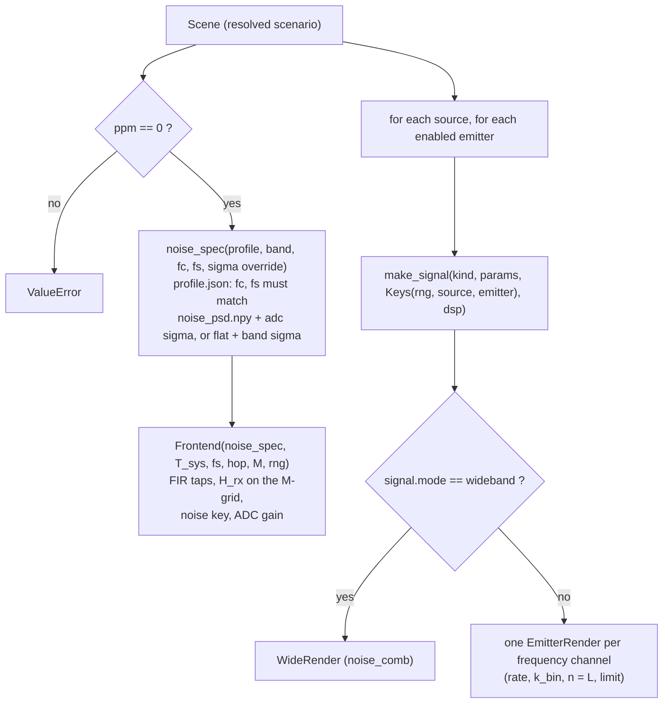

`noise_spec` raises if the profile was made for a different `fc`/`fs` than the scenario. Without a profile, the band's flat shape and `noise.sigma_counts` (26.687) are used; `frontend.noise_sigma_counts` overrides either.

### 9.4 Control samples: amplitude and carrier phase

For chunk `c` each `EmitterRender` computes a **`Control`** (`_compute_control`). Control samples are on **whole Unix milliseconds** `k` from `k0 = 1000 c` through `k0 + 1000 + 2 * 10 + 1` (1 021 samples: one second plus 20 ms, so that the interpolation covers all 101 half-blocks of the chunk).

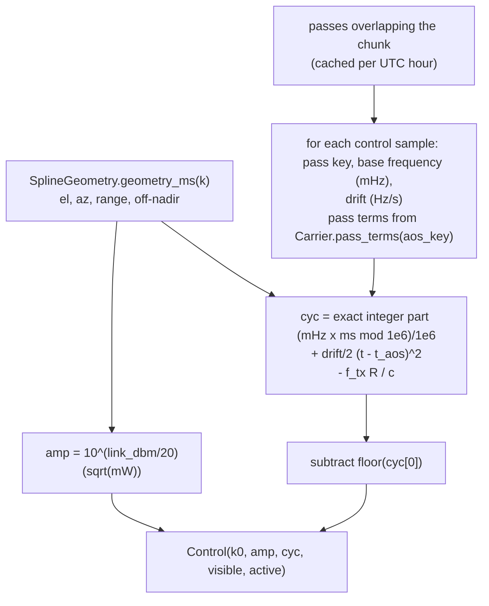

* **Amplitude** `amp = 10^(P_rx/20)` with `P_rx` from the **link budget alone** at the emitter's rest frequency: no schedule, no AM, no fade. (Those are applied later, at the narrow rate.)
* **Carrier phase**, in *cycles relative to the coarse bin*:

  ```
  phi(t) = integral (f_tx - f_bin) dt  +  (drift/2) (t - t_aos)^2  -  f_tx(t) R(t) / c
  ```

  The first term is **exact**: for a constant `delta = (base - f_bin)` in integer mHz and times in integer ms, `delta * (k - k0)` is a whole number of micro-cycles; the phase at the chunk start `(delta * k0) mod 10^6` is computed with Python integers (`delta` can differ per sample if
  a pass starts mid-chunk, so it loops over `np.unique(delta)`), then divided by 10^6. Thus the carrier is phase-exact at any distance from the epoch.
  The last term, `-f_tx R / c`, **is the Doppler**: its derivative is `-f_tx * dR/dt / c`. Its magnitude is ~4.6e5 cycles (137 MHz x 1000 km / c), well inside float64's resolution.
  The result is reduced by `floor(cyc[0])` to keep numbers small (a constant whole-cycle offset is invisible).
* Samples within `PASS_PAD_S` = 2 ms outside a pass use that pass's carrier terms (so interpolation at the edges is smooth).
* `visible` = the passes' `(aos, los)` pairs; `active` = `visible ∩ schedule's active intervals`.

**Ground and local emitters** (`_control_fixed`) have no geometry: a constant amplitude `10^(rx_dbm/20)`, and `cyc` from the constant `rest - f_bin` offset by the same exact-integer method; `visible` is "always".

### 9.5 From control samples to a narrow stream

`EmitterRender._compute_stream(chunk)` produces the emitter's samples for **blocks `100c .. 100c + 99`**: narrow indices `[100 c L/2, (100 c + 101) L/2)`, i.e. `101 * L/2` samples, starting at the narrow sample of Unix second `c`
(because `100 * L/2 = r`, the stream always starts on a whole second). Alongside, a **uint8 flag per block** says whether the emitter can be non-zero in that 20 ms block (`tb0 < interval_end and tb1 > interval_start` for any active interval).
If no flag is set, the whole chunk returns `None` and the emitter costs nothing.

Steps:

1. `t = (n0 + j) / rate` for the narrow samples; `pos = j * 1000 / rate` ms from the first control sample.
2. **`np.interp`** (linear) of `amp` and `cyc` onto the narrow grid. (Phase is smooth: second differences over 1 ms are negligible, and the range term's curvature is far below a millicycle.)
3. **Fade** `fade(t, visible, fade_s)` ([7.5](#75-fade-the-horizon-replacement)), evaluated at the narrow rate.
4. **Signal samples `x`**, depending on mode:
   * continuous signal: `x = signal.render(n0, k, rate)` (or `None` for `cw`), `env = schedule.envelope(t) * fade`;
   * event signal on a satellite: `x = signal.render_events(events overlapping the span, n0, k, rate)`, `env = fade`;
   * per-event path: `_events_x` (below).
5. **AM**: `env *= 10^(am.gain_db(t) / 20)`.
6. **`dsp.nco(x, amp * env, cyc)`**: `out[j] = x[j] * gain[j] * exp(j 2 pi (cyc[j] - floor(cyc[j])))` in double, rounded to complex64. This single kernel applies level, schedule, fade, AM, Doppler and carrier offset.

**Per-event emitters (ground/local events, and anything with `per_event`)** render **each event separately** (`_events_x`): for every event touching the chunk,

* an event signal renders itself (`render_events([ev], ...)`); a continuous signal under an event (a `cw` carrier burst) is `signal.render(...) * event_envelope(t, start, end, ramp)`;
* it is multiplied by the event's own gain `10^(level_db/20)`;
* and shifted by its own offset: `exp(j 2 pi offset * (m - start_sample) / rate)`, phase zero at the event's first sample;
* then summed into `x` (overlapping events on one channel simply add - two aircraft keying up together beat).

### 9.6 The overlap-add synthesiser

This is the heart. The kernel `dsp.synth(streams, lens, bins, active, b0, nb, m, h_rx, out)` (`cpp/synth.cpp`, twin `dsp_ref/synth.py`) turns many narrow streams into one wideband signal.

For output block `b` (absolute) and an active emitter `e` with narrow block length `L`, coarse bin `k` and narrow stream `x`:

```
v[j]  = x[i L/2 + j] * w_L[j]                      j = 0..L-1, w_L = periodic Hann (w[j] + w[j + L/2] = 1)
V     = FFT_L(v)                                   unnormalised
A[(k + j) mod M] += V[j mod L] * (M / L) * (-1)^(k b) * H_rx[(k + j) mod M]     j = -L/2 .. L/2 - 1
y_b   = IFFT_M(A)  (scaled 1/M)                    summed over ALL emitters first
out[(b - b0) N : (b - b0) N + M] += y_b            overlap-add, hop N
```

Why each piece is there:

* **Same bin spacing.** The narrow block covers `L / r = M / fs` = 20 ms exactly, so the narrow FFT's bins are `r / L = fs / M` = 50 Hz apart, the *same spacing as the wideband FFT*. Moving a narrow spectrum to its place in the wideband spectrum is therefore a pure index shift by `k` - no resampling filters.
  `V` is stored as `[bins 0..L/2-1, bins -L/2..-1]`, hence the two `add_scaled` calls (`spec[:half]` at `k`, `spec[half:]` at `k - half`).
* **`M / L`.** Compensates the unnormalised length-`L` FFT versus the `1/M` IFFT, so a tone of amplitude `A` comes out with amplitude `A` (times the window). It is also *band-limited interpolation*: the zero bins outside `+-L/2` mean the narrow samples are interpolated up to `fs` with an ideal brick-wall filter. Hence the 1.25 margin in the narrow-rate rule.
* **The Hann window comes first.** Each block's windowed signal goes to zero at both edges, so the circular nature of the FFT does not create wrap-around artefacts, and 50 %-overlapped Hann windows sum to exactly 1 - the overlap-add is seamless.
* **`(-1)^(k b)`.** The block `b` starts at absolute sample `b N`. Shifting a spectrum by `k` bins is multiplication by `exp(j 2 pi k n / M)` over the block's local index `n`; referred to the *absolute* sample index it
  carries the extra phase `exp(j 2 pi k b N / M) = exp(j pi k b)` = `(-1)^(kb)`. Without it, the carrier would jump in phase between successive hops by `pi` for odd `k` on odd `b`. Only the parity of `k` and `b` matters, which is why a sign flip suffices.
* **`H_rx`.** The receiver response is multiplied on the wideband grid during the placement - see 9.7. It is a real, non-negative per-bin gain (`None` when the profile is flat).
* **All emitters are summed in the frequency domain per block**, then one IFFT. Cost: per block, `sum over active emitters of FFT_L` + **one** `IFFT_M`. `IFFT_BATCH = 1` on purpose (batching 4 IFFTs is faster alone but needs 1.5 MB and overflowed the shared L3 cache with six workers: measured 1.9x vs 3.8x real time).
* **Inactive blocks are skipped** for that emitter; a block with no active emitter costs nothing and produces zeros.

**Chunk assembly with the carried half-block** (`Renderer.signal`, `_tail`, `_keep_tail`):

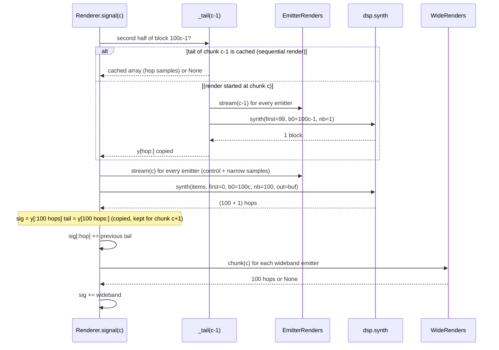

The recomputed tail is bit-identical to the one a sequential render would have carried, because **every FFT gives the same bits whichever batch it runs in** (pocketfft's SIMD lanes do not change the arithmetic of any one transform) and the kernels use no FMA contraction. A render therefore never "starts cold": the cost is that
its first chunk also computes control and narrow samples for the chunk before (~1 % for the 4 s worker tasks).

### 9.7 The receiver front end (`engine/frontend.py`)

Three jobs: shape the noise like the measured receiver, shape the signals the same way, and quantise.

#### Noise shape -> FIR
The profile's `noise_psd.npy` is 16 384 float32 values: the measured noise power spectrum in dB, fftshifted, 0 dB = the median of the flat passband (136.2-137.8 MHz), VDL channels, birdies and the DC spike interpolated out, smoothed over ~4.5 kHz.
`design_fir` converts it into a **513-tap zero-phase FIR** by frequency sampling: amplitude `10^(dB/20)`, `ifft(ifftshift(.))`, keep the central 513 taps with no taper (smooth shape: 0.03 dB RMS error across 135.85-138.15 MHz). The taps are Hermitian, so the response is real. No profile -> a single tap (flat).

#### Receiver response for signals
`fir_response(h, M)` is `|FFT_M|` of the FIR placed on the 48 000-bin grid, as float32. **The same shape is applied to signals** (inside the synthesiser, `H_rx`) **and to noise** (by filtering), so the calibrated C/N0 holds at every frequency: SNR does not depend on where in the band a signal sits, only on the link budget. (The real SAW filter's roll-off near 136.0 MHz shows up in both.)

#### Noise generation
```
white(key, hop h, samples i0..i1):  for pair index j in [i0/2, i1/2):
    counter = (j, 0, h_lo, h_hi);   words = Philox4x32-10(counter, key)         # 4 x uint32 per call
    sample 2j   = BoxMuller(words[0], words[1])
    sample 2j+1 = BoxMuller(words[2], words[3])
```
`key = KeyedRng.key64("noise")`; the counter's high words are the **absolute hop index** `h`, so hop `h`'s white noise is a pure function of `h`. Box-Muller is done in float32 with hand-rolled polynomial `ln`, `sin` and `cos` ([10](#10-the-c-kernels-and-their-numpy-twins))
so C++ and numpy produce the same bits.

#### Shaping by overlap-save
Each hop is filtered in segments of `sub = hop / 3` = 8 000 samples (`NOISE_SPLIT = 3`: a batch of four 8 640-point transforms fits in L2). For each segment the row holds the **512 white samples before it** (from the previous hop for a hop's first segment, which is why `dsp.noise` requires `h0 >= 1`),
then its own 8 000, then zeros up to `ols = next_smooth(8 000 + 512) = 8 640` (= 2^6 x 3^3 x 5). Row -> FFT -> multiply by the precomputed spectrum of the taps -> IFFT -> keep samples `[512, 512 + 8000)`. Each hop depends only on its own draw plus the last 512 samples of the previous hop's draw,
so hops are independent and any one can be computed alone.

#### Absolute calibration
```
p_flat   = k T_sys * fs * 1000                     mW   (white noise power over the whole band, 0 dB of the shape)
scale    = sqrt(p_flat / 2)                         per I/Q component, for unit-variance white input
sigma_mW = scale * sqrt(sum |h|^2)                  per component after the FIR      [sqrt(mW)]
G        = sigma_counts / sigma_mW                  ADC gain, counts per sqrt(mW)
```

Measured with the default profile: `T_sys` = 726.6 K, `sigma_counts` = 26.687, **G = 8.2077e6 counts / sqrt(mW)**. Signals are in sqrt(mW) too (amplitude `10^(P_rx_dBm/20)`), so a 45 dB-Hz carrier
(power `k T_sys * 10^4.5` = 3.17e-13 mW) has amplitude 5.63e-7 sqrt(mW) = **4.62 counts** against noise of 26.7 counts RMS per component. (Spread over the 2.4 MHz band the noise is 63.8 dB above `k T` in 1 Hz.)

#### ADC
```
u = clip( rint(127.5 + G * (signal + noise)), 0, 255 )          interleaved I, Q, I, Q, ...
```
`dsp.adc(sig, gain, add=noise, out=buf)` quantises with round-half-to-even implemented as `(v + 2^23) - 2^23` after clamping to `[0, 255]` (valid because rint is monotonic and the bounds are integers). A strong signal clips at 0 or 255.
**Not modelled** (accepted in the config but unused): `tuner_gain_db`, `image_db`, `iip3_dbm`; no DC spike, no IQ image, no intermodulation, no ppm error, no diurnal noise-level variation.

### 9.8 Caches, prefetch and speed

* **Per `EmitterRender`**: `_ctl` (2 chunks), `_streams` (2 chunks), `_hours` (4 hours of passes). **Per schedule**: 6 hour slots. **Per `SplineGeometry`**: 8 hour blocks. **Per signal**: OQPSK keeps 24 frames; SDPSK 8 bit blocks; LoRa/D8PSK/GFSK nothing (events are rebuilt).
* **Renderer buffers**: 19 MB complex64 `sig` (101 hops), 19 MB `noise`, 19 MB `iq`, 4.8 MB `u8`, allocated once and reused ("fresh 19 MB arrays every chunk cost page faults, which contend between worker processes"). Consequently **`chunk_u8(c)` returns a view valid only until the next chunk**; `u8()` copies.
  The single-slot caches `_sig`, `_nz`, `_iq`, `_u8` remember which chunk they hold.
* **Stage timers** (`Renderer.times`): `control` (Python: per-emitter control and narrow samples), `synth`, `wideband`, `noise`, `adc`, `prefetch`. `assist bench` prints them per second of stream.
* **Live prefetch** (`prefetch=True`, serving sinks only): in the last 60 s of each UTC hour the renderer precomputes **the next hour's** event slots (one schedule per chunk) and passes/geometry (a few emitters per chunk, finished within ~30 s), so the hour boundary - where every
  `SplineGeometry` needs a fresh block and every schedule a new slot - costs no more than any other second.
* **Speed** (figures from the README, measured on the dev machine): one core renders the 50-source `realtime.yaml` at ~7x real time; the multi-process file render reaches 20-30x on 6 cores. ~1.3x with `ASSIST_PURE=1` on 20 carriers.

### 9.9 Why any window gives the same bytes - the full state audit

The only state that crosses a chunk boundary is listed here, each with how it is made window-independent:

| State | Where | Made independent by |
|---|---|---|
| Half-block overlap between chunks | `Renderer._tails` | Recomputed on demand from chunk `c-1` ([9.6](#96-the-overlap-add-synthesiser)) |
| Carrier phase | `Control.cyc` | Absolute time; exact integer reduction; no integrator |
| Pass offset/drift | `Carrier.pass_terms` | Keyed by `aos_key`, a property of the pass, not the window |
| Schedule events | `_EventSchedule` slots | Keyed by hour; generated in full from the stream |
| Symbols/frames/payload | each signal | Philox counter = absolute index; filters read neighbouring symbols from their absolute indices |
| Filter history of noise-like signals | `noise_band`, `am` audio | White noise keyed per absolute block; history comes from the previous block |
| Receiver noise | `Frontend.noise` | Philox counter = absolute hop; history from hop `h-1`'s draw |
| Burst waveforms | gfsk, lora, d8psk, am | Built whole from the event's start (microsecond counter); sliced |
| Geometry | `SplineGeometry` | Splines on a window-independent hourly grid |

The test `test_render_window_independence` renders a stretch directly and as a slice of a longer render and requires identical bytes; `test_pool_bytes_equal_one_process` does the same across worker counts. A direct check, run while writing this document: two separate `Renderer`s, one asked for a window starting 8.7 s earlier than the other, return the same 4 800 000 bytes for the second they share.

### 9.10 Errors the engine raises (and what they mean)

| Message | Cause |
|---|---|
| `narrow rate ... Hz would exceed the sample rate` | A signal plus its Doppler wouldn't fit in 2.4 MHz. |
| `frequency excursion ... exceeds ...` | A carrier left its narrow band: a rate/drift/offset bigger than the bound the rate was chosen for. |
| `pass without a key` | A pass lacked an `aos_key` (cannot happen with SplineGeometry). |
| `frontend.ppm must be 0 (the crystal error is not modelled)` | Reached only when a scenario bypasses the schema, which refuses `ppm != 0` first. |
| `<kind> is not an event signal` / `... needs exp_gaps or poisson_events` | Event signals need an event schedule. |
| `exp_gaps: event durations (max_s) must not exceed min_gap_s` | Slots could overlap. |
| `profile ... is for fc ..., fs ...` | The profile's band parameters don't match the scenario's front end. |

---

## 10. The C++ kernels and their numpy twins

All numeric heavy lifting is in one extension module, `assist._dsp` (`cpp/`, built by scikit-build-core + CMake + pybind11 on `uv sync`). Properties of the whole module:

* **Single-threaded**, pocketfft compiled with `POCKETFFT_NO_MULTITHREADING` (parallelism is by processes). Scratch buffers are `thread_local` and only grow.
* **GIL released** around every kernel call; arguments are validated first (`require(...)`), 1-D C-contiguous arrays, `out=` buffers checked for exact dtype, length and writability so a kernel never writes into a converted copy.
* **Deterministic floats**: compiled `-O3 -ffp-contract=off` (no FMA contraction, no `-ffast-math`), so a C++ result and its twin evaluate the same expression in the same order. `ASSIST_NATIVE=ON` adds `-march=native` for local use only and sets `assist._dsp._native = True` (recorded in `run.json`'s engine name).
* **pocketfft** (vendored, header-only): FFTs run several transforms at once in SIMD lanes (~2.2x faster) and each transform's bits do not depend on its lane or batch.

| Kernel | File | What it does | Notes |
|---|---|---|---|
| `scale(x, g)` | `basic.hpp` | `x * g` | Complex product written out by hand to avoid C99 Annex G NaN recovery. |
| `synth(streams, lens, bins, active, b0, nb, m, h_rx, out)` | `synth.cpp` | OLA synthesis ([9.6](#96-the-overlap-add-synthesiser)) | Per emitter: Hann-windowed rows -> one batched FFT of all its active blocks (`block_spectra`), cached periodic Hann windows by length; per block: accumulate spectra (`add_scaled` handles wrap-around mod `M`, `H_rx` multiply), one IFFT, add into `out`. |
| `white(key, h0, nhops, hop)` | `frontend.cpp` | Gaussian noise | Philox counter `(j, 0, h_lo, h_hi)`; 2048-sample passes so the 16 KiB of Philox words stay in L1. |
| `noise(key, h0, nhops, hop, sub, taps_f, n_hist, out)` | `frontend.cpp` | Shaped noise | Overlap-save, 4 segments batched (SIMD lanes), every row drawn straight from the generator; requires `h0 >= 1`. |
| `adc(x, gain, add, out)` | `frontend.cpp` | Quantiser | `quantise()` trick for round-half-even. |
| `random_bytes(key, block, n)` | `modem.cpp` | Payload bytes | Philox counter `(i, 0, block_lo, block_hi)`, 16 bytes per call, little-endian words. |
| `shape(si, sq, k0, h, sps, qd, n0, n)` | `modem.cpp` | Pulse shaping | Polyphase branch `branch()`: taps split into `sps` phases, symbols in a zero-padded double array, 64 outputs interleaved to hide add latency, sum order fixed (ascending `i`), **double accumulators**. I and Q are two calls (Q at `n0 - qd`). |
| `chirp(start, len, val, sf, bw, t0, dt, n)` | `modem.cpp` | LoRa waveform | Analytic phase per sample ([8.7](#87-lora---spacebee-style-lora-bursts)); segment pointer advances monotonically. |
| `nco(x, gain, cyc)` | `modem.cpp` | `x * gain * exp(j 2 pi cyc)` | In double, rounded to complex64; `x = None` means constant 1 (CW). |
| `conv_encode(bits, state)` | `conv.cpp` | K=7 r=1/2 encoder | 7-bit register, newest bit in bit 0; polynomials `0x4F` / `0x6D` (171 / 133 octal bit-reversed); parity by xor folding. |
| `ccsds_randomise(data)` | `conv.cpp` | CCSDS scrambler | 8-bit LFSR, `b[k+8] = b[k+7]^b[k+5]^b[k+3]^b[k]`, seed all ones. |

**The Gaussian noise generator in detail** (`frontend.cpp`, mirrored line for line in `dsp_ref/frontend.py`):

* Philox4x32-10 (`philox.hpp`): ten rounds of two 32 x 32 -> 64-bit multiplies with constants `0xD2511F53`, `0xCD9E8D57` and key schedule `+0x9E3779B9`, `+0xBB67AE85`. numpy's own `Philox` is the same algorithm (this is also why `KeyedRng` uses it).
* Box-Muller needs `ln`, `sin`, `cos`; libm's differ between platforms. So they are **polynomial approximations in float32 using only `+ - * /` and `sqrt`** (all exactly rounded):
  `ln_poly`: split `x = m 2^e` with `m` in [sqrt(1/2), sqrt(2)), `ln m = 2 atanh((m-1)/(m+1))` by its series to `s^9`; `sin`/`cos`: the **top two bits of the second word pick a quadrant** (an exact rotation), the next 24 bits give an angle in `[-pi/4, pi/4)`, evaluated by Taylor series to `t^9`/`t^10` (error < 2e-9).
  Because this is deterministic IEEE arithmetic, the noise is **bit-identical across compilers, OSes and the numpy twin**.

**The twins** (`src/assist/dsp_ref/`, one module per C++ source) have the same names, signatures and dtypes; `tests/test_dsp_ref.py` compares them (`white`, `adc`, `random_bytes`, `conv_encode`, `ccsds_randomise` exactly; the others to rtol 1e-5).
`assist/backend.py` selects: `ASSIST_PURE` set to anything but `""`, `0`, `false`, `no` -> numpy, else the C++ module; **there is no silent fallback** (a missing C++ module is an ImportError unless `ASSIST_PURE` is set). `assist --version` prints which is in use.

C++ edits need no reinstall: with the editable install, `editable.rebuild = true` re-runs CMake on the next import (`build/{wheel_tag}` is a fixed build dir for exactly that).

---

## 11. Outputs: files, waterfall, rtl_tcp, run.json, workers

Every sink consumes the same thing: a sequence of `uint8` arrays (interleaved I, Q) in order. They differ in where it goes.

**The sink protocol** (`sinks/base.py`). A sink is a class registered with `@register_sink("name")`, with a pydantic `Params` model for its settings. A scenario lists sinks under `sinks:` as one-key mappings; `check_sinks` validates each entry against the sink's `Params` at schema time. There are two flavours:

| | Push sink (`Sink`) | Serving sink (`ServingSink`) |
|---|---|---|
| Core examples | `wav`, `cu8`, `fft` | `rtl_tcp` |
| How it gets the stream | `write(u8)` for every piece, in order, as fast as it renders | pulls from a `RenderAhead` ring inside `async serve(ahead)` |
| Per run | any number together | exactly one, and nothing else |
| Stream length | finite: `--duration`, else the scenario clock; the sink may plan less (`planned()`) | endless unless `--duration` |
| Lifecycle | `__init__(params, ctx)`, `planned()`, `files()`, `open()`, `write()`..., `close()` or `abort()`, `info()`, `summary()` | `__init__`, `serve()`, `info()`, `summary()` |

Both are built from a `SinkContext`: `fs`, `fc_hz`, `n0`, `n` (or `None`), the output directory, the station time zone, an `RngScope` under `("sink", name)`, the scenario hash, and for a live stream the wall-clock start.

**The runner** (`sinks/runner.py::run`, the whole of `assist run`) owns everything a sink should not have to repeat: choosing the sinks (`select_sinks`: the scenario's list, or `--sink` names; push sinks only or exactly one serving sink, a mix is refused with a message that names `--sink`), building `Scene` and `Renderer` once, the overwrite check on every sink's `files()`, `run.json` before and after, progress lines, and the mapping of errors to exit codes (`RenderError` -> 2, `OSError` -> 1, a refused overwrite -> 1, Ctrl-C -> status `stopped`). In a push run each piece goes to every sink until that sink has the samples it planned; the run ends when all have theirs, so an `fft` sink with a short `duration` next to a `cu8` sink ends early while the file continues.

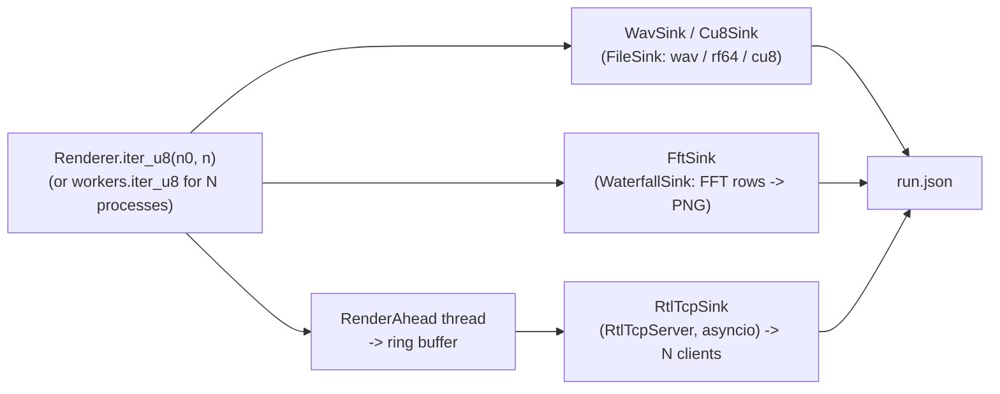

### 11.1 File sinks (`sinks/wavfile.py`)

| Format | What it is |
|---|---|
| `wav` | PCM WAV, 2 channels, 8-bit unsigned, `fs`. The header is the **canonical 44 bytes** (`RIFF` + `fmt ` + `data`, nothing else) because SDR++'s file source reads a fixed layout. **Split every 600 s** (2.88 GB at 2.4 MS/s, under the 4 GiB RIFF limit). |
| `rf64` (`wav` with `rf64: true`) | One file of any length: `RF64`, `ds64` (64-bit sizes), `fmt `, `data`; the 32-bit size fields hold `0xFFFFFFFF`. (SDR++ 1.2.1's WAV source does not read RF64.) |
| `cu8` | One headerless file of interleaved bytes, exactly what `rtl_sdr` writes. |

* **Naming** follows SDR++: `baseband_137000000Hz_HH-MM-SS_DD-MM-YYYY.wav`, the file's first-sample time **in station local time** (`station.tz`, a fixed offset like `+03:00`), truncated to the second.
* `plan_files(...)` returns `OutFile(path, first, n_samples, start_sample)` for each file; `first` counts from the start of the render, `start_sample` is the absolute sample index. Duplicate names (a split shorter than 1 s) are refused.
* `FileSink.write(u8)` takes pieces of any size, straddling file boundaries; `close()` checks that the planned number of samples was written. The registered sinks `WavSink` and `Cu8Sink` are thin wrappers (`_FileStreamSink`) that plan the files from the `SinkContext` and forward to it.
* **Headers are written with their final sizes up front**, so an interrupted render leaves files whose headers claim too much; readers that tolerate that (SDR++, `profile.wavio`) read to the end.
* The runner refuses to overwrite (`--force`), writes `run.json` with status `rendering` before the first byte and `complete` after the last, prints progress every 60 s of stream, and reports `x real time`. The default output directory is `out/<scenario name>`.

### 11.2 The waterfall sink (`sinks/fft.py`, `waterfall.py`)

A parametrised copy of the capture script that made the station's real waterfalls, so ASSIST output can be compared pixel for pixel with the real thing.

* A **row** is the mean of `|FFT|^2` over `avg_count = max(1, round(row_seconds * fs / width))` consecutive non-overlapping `width`-point FFTs (**Nuttall window**, fftshifted, float64 accumulation), so a row lasts `avg_count * width / fs` (the requested `row_seconds` to within one FFT).
* Bytes are converted to IQ as `(u - 127.5) / 127.5`. Power is scaled by `16384 / width`, so a given dB reads the same for any width.
* **Pixel** `= clip((10 log10(mean + 1e-12) - min_db) / (max_db - min_db) * 255, 0, 255)`, truncated (not rounded) to `uint8`.
* **Levels**: both `min_db`/`max_db` given, or neither. Neither: `min_db` = mean over bins of the spectrum (in dB) of the first 5 s, minus 5, and `max_db = min_db + 30`; rows are *held* until the calibration is known, then drawn.
* The image is `width` columns by `floor(duration * fs / row_samples)` rows, oldest at the top. The sink never runs open-ended: `FftSink` limits the spec to the run's stream (`spec.limited`), and its own `duration`, when shorter, makes it finish early (`planned()`). It accepts pieces of any size, so the result is independent of chunking.
* The PNG is written via a `.png.part` file and renamed; an interrupted run keeps the finished rows.

### 11.3 The rtl_tcp server (`sinks/stream.py`, `sinks/rtltcp.py`)

Serving is split in two. `stream.py` holds what any serving sink needs: `RenderAhead` (the render thread and its ring), `StreamServer` (accepting clients, pre-roll, pacing, live start, fan-out, stall accounting, the backlog guard, the status line) and `StreamSink` (a `ServingSink` made of one `StreamServer`). A protocol is a `StreamServer` subclass with three hooks: `greeting()` (bytes sent on connect), `read_client(reader, peer)` (what to do with what a client sends) and `encode(chunk)` (how a chunk goes on the wire).
`rtltcp.py` is the rtl_tcp protocol in those terms: the dongle header as greeting, the 5-byte command parser in `read_client`, the bytes unchanged. The example plugin `examples/plugins/tcp_sink.py` is another protocol on the same base (no header, cu8/cs16/cf32 encoding).

The `rtl_tcp` sink of `assist run` speaks the protocol of librtlsdr's `rtl_tcp`, so SDR++'s **RTL-TCP** source (or anything that uses `rtl_tcp`) connects as if to a real dongle.

**Protocol.** On connect the server sends 12 bytes, `"RTL0"` + big-endian `uint32` tuner type (5 = R820T) + `uint32` gain count (29); then an endless stream of interleaved `uint8` IQ. The client may send **5-byte commands** (`uint8` command, big-endian `uint32` parameter): set frequency, sample rate, gain, AGC, bias-tee, ...
They are **logged with the stream position and ignored**, because the tuning is fixed (a note is added if the client asks for a different frequency or rate).

**Architecture.**

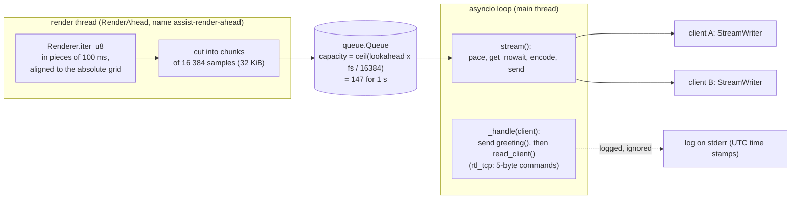

The render thread holds the GIL only for the Python control plane; the C++ kernels release it, so the event loop stays responsive.

**Timeline of a realtime stream.**

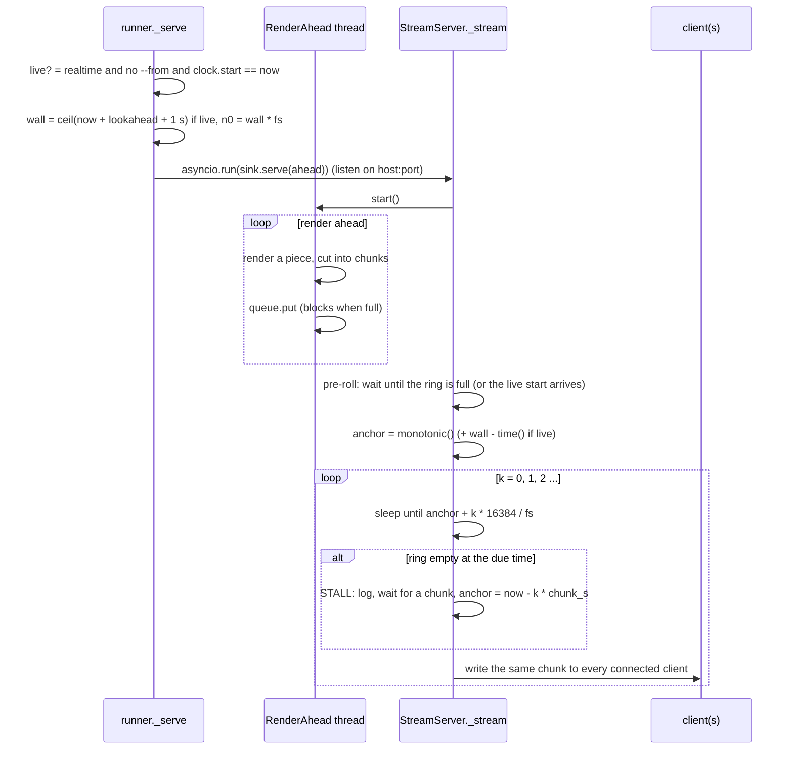

* **Live mode.** With `clock.start: now` (and no `--from`), `n0 = wall * fs` with `wall` a whole second slightly in the future, and the anchor is that wall time: **sample time equals wall time** for the entire session. SDR++'s waterfall then shows the satellites that are really overhead. Otherwise the stream starts at `--from`/the clock start and is merely paced at real time.
* **Pre-roll.** The stream starts only when the ring is full (`lookahead` seconds rendered) - or, in live mode, when the planned start time arrives, in which case it warns `pre-roll incomplete`. With ~50 sources the first second needs a few seconds to prepare, hence `lookahead: 4s` in `realtime.yaml`'s `rtl_tcp` sink.
* **Stalls.** If the ring is empty at a chunk's due time the stream waits, logs it, and moves the anchor by the stall's length: *content is unchanged, only the wall-clock alignment slips*. `run.json` counts `stalls` and `stall_s`.
* **Fan-out.** Every client receives exactly the same chunks, from the first chunk sent after it connects (`_Client.since` records the absolute sample). **With nobody connected the chunks are dropped and the stream keeps running**, so time keeps tracking the wall clock.
* **Backlog guard.** There is no per-client dropping (clients are assumed local), but a client whose unsent data exceeds `max_backlog_s` = 10 s of stream (48 MB) is disconnected so a stuck client cannot exhaust memory (counted as `slow_disconnects`). The limit is a `StreamServer` argument; the example `tcp` sink makes it a setting.
* **`pacing: unpaced`** (a sink setting)**.** Chunks go out as fast as the slowest client reads (`drain()` back-pressure), and the stream *holds* while nobody is connected. Used by tests and for fast piping into another tool.
* A status line (clients, ring fill, minimum fill, stalls) is logged every 60 s. Ctrl-C stops the server; `finally` closes clients and joins the render thread.

### 11.4 `run.json` (`sinks/runinfo.py`)

Written atomically (`.json.part` then rename) into the output directory of every run, first with status `rendering`/`serving`, then again at the end (`complete`, `stopped`, `error`). It is **provenance, not truth**: truth is always recomputed from the scenario.

```
status, assist_version, engine ("c++" | "c++, -march=native" | "numpy reference"), scenario_hash, clock_start
api_version
plugins:  [{plugin, version, api, sha256, module, file, distribution, registers}, ...]   (those the scenario loaded)
render:   fc_hz, fs_hz, start_sample_abs, start_utc, n_samples (null: endless), duration_s, station_tz
noise:    source (e.g. "profile profiles/vhf137"), sigma_counts, adc_gain_counts_per_sqrt_mw, t_sys_k
emitters: [{id, narrow_rate_hz, f_bin_hz}, ...]
sinks:    [{kind, params, info}, ...]   one per sink that ran; `info` is what the sink reports:
            wav/cu8 {format, samples_written}, fft {width, height, min_db, max_db, ...},
            rtl_tcp {host, port, pacing, live, lookahead_s, stream{samples, seconds, stalls, stall_s, clients, slow_disconnects}}
files:    [{name, first_sample, n_samples, start_sample_abs, start_utc, duration_s}, ...]
(extras)  workers, render_seconds   (push runs)
scenario: the complete resolved scenario
```

Because the resolved scenario is inside, **`run.json` alone is enough to reproduce the exact stream** (`assist run run.json ...` would not parse it directly, but `run.json["scenario"]` is a valid resolved scenario).

### 11.5 Parallel rendering (`engine/workers.py`) and `bench`

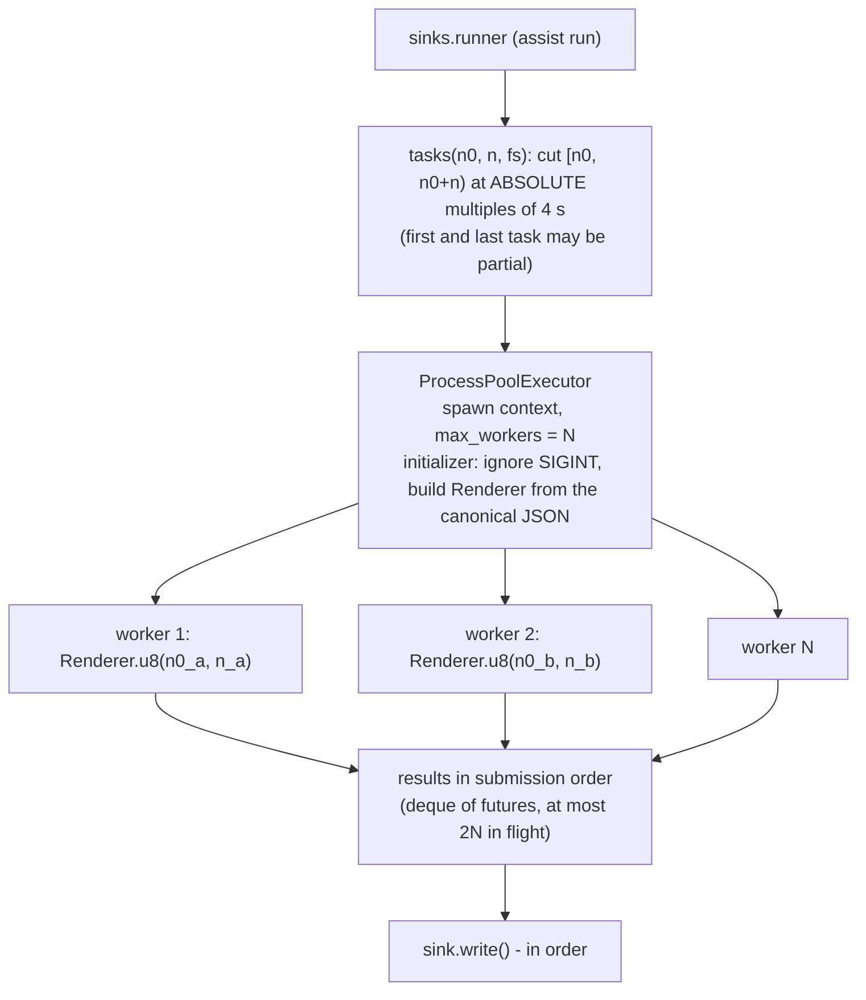

* Processes, not threads: the per-chunk **control plane is Python and holds the GIL**; the C++ kernels release it but cannot carry the whole load.
* Workers receive only `canonical_json`, `base` and the table of where the parent found its plugin files (`plugins.located()`), and build their own `Renderer`. Each worker activates the scenario's plugins itself before validating the JSON, checking a file plugin's sha256 against the resolved scenario. Each task's first chunk recomputes the previous chunk's tail itself, which costs about 1 % for 4 s tasks.
* The result bytes are **identical for any worker count** (`bench` checks this by hashing both streams with BLAKE2b and exits non-zero if they differ).
* `assist bench`: (1) on one worker, renders after a 1 s warm-up and prints `x real time` plus **ms per second of stream spent in each stage** (`control`, `synth`, `wideband`, `noise`, `adc`, `other`); (2) on N workers, starts the pool, renders `N x 4 s` as warm-up (timed separately), then times the window; writes `out/bench/<scenario>.json`.

---

## 12. Truth, passes and the catalog

These commands never render a sample; they ask the `Scene` analytic questions.

### 12.1 `assist passes`

For every source with a non-fixed platform, `platform.passes(a, b)` ([6.6](#66-passes-and-pass-keys)); then geometry at AOS, TCA and LOS gives the three azimuths. Output: `source_id, norad, name, aos_utc, tca_utc, los_utc, max_el_deg, aos_az, tca_az, los_az, duration_s`, sorted by AOS; as a table or `-o CSV`.
(Building the `Scene` here also validates schedules, so an `exp_gaps` violation shows up even though nothing is rendered.)

### 12.2 `assist truth`

`truth.compute(scene, t0, t1, step, platforms)` produces two tables.

**Rows (continuous emitters, one per step while the satellite is above the horizon)**

| Column | Meaning |
|---|---|
| `t_utc` | `t0 + k * step`, to the millisecond |
| `source_id, emitter_id, signal, norad, in_catalog` | identity (norad empty for ground/local and uncatalogued) |
| `f_rest_hz` | `f_nominal + offset_hz` |
| `f_tx_hz` | `f_rest` + per-pass offset + drift term |
| `f_rx_hz` | `f_tx + doppler` **exactly** (see below) |
| `doppler_hz` | `-f_tx * range_rate / c`, first order |
| `el_deg, az_deg, range_km, range_rate_mps` | geometry (empty for ground/local) |
| `rx_dbm` | link budget **plus the AM tumble gain** at that instant (the fixed `rx_dbm` for ground/local) |
| `cn0_dbhz` | `rx_dbm - 30 - 10 log10(k T_sys)` |
| `active_fraction` | share of `[t, t + step)` in which the schedule is on (half-amplitude edges) |

Frequencies are held in **integer millihertz** (`TruthArrays.f_tx_mhz`, `doppler_mhz`), printed with `fmt_mhz` (`123456789.123`), so `f_rx = f_tx + doppler` holds *to the last digit of the file*. Other precisions are fixed: angles 1e-6 deg, range 1 mm, range rate 0.1 mm/s, levels 0.001 dB; `-0.0` prints as `0.0`; NaN prints as an empty cell. The text is therefore identical on every machine (**T-DET**, with a committed golden file).

The step is irrelevant to the physics: `truth` is evaluated at the times asked, and a window is independent of the others (long spans are processed one geometry hour at a time to keep the spline cache small).

What truth deliberately **does not** include: the 15 s fade ramps (rows exist for the whole pass at full link-budget level); the per-sample envelope of ramps; noise. `active_fraction` is the schedule only.

**Event table** (every burst of every event emitter overlapping `[t0, t1)`): `start, end, source_id, emitter_id, signal, f_rx_hz, rx_dbm, cn0_dbhz, params` (JSON of the event's parameters: `sf`, `payload_bytes`, `symbols`, `bits`, `offset_hz`, `level_db`, `channel`, `duration_s`, ... rounded to 6 decimals).
For a satellite, the event is kept only if its **midpoint** is above the horizon; frequency and level are evaluated at the midpoint, on the event's own channel (`shift = channel_rest - carrier_rest` is added to `f_tx` and the Doppler recomputed for it, and the link budget at that frequency).
Per-event draws are added: `+ offset_hz` to the frequency, `+ level_db` to the level. A `noise_comb` episode has no single frequency or level, so those cells are empty (its `amplitude_db` and `spacing_hz` are in `params`).

`--platforms` filters by registered platform name (`satellite,ground,local`, or one from a plugin; an unknown name is an error; default: all); `--format jsonl` writes JSON lines with the same fixed-precision text. Output files: `<out>` and `<stem>.events.<fmt>`.

### 12.3 `assist catalog` - what the tracker is given

`orbits/catalog.entries(scenario, base, sources_only)`:

1. Start (unless `--sources-only`) from the **whole element store**: for every NORAD id in `elements.files`, the set nearest the clock start.
2. For each source: a catalog orbit with `in_catalog` -> put its **published** OMM (so a `perturb`ed true orbit appears unperturbed: this is the whole point); `in_catalog: false` -> **remove** the id (a "leave-one-out" test: the tracker doesn't know this satellite).
   A synthetic/Kepler source with `in_catalog: true` -> add a synthetic OMM under `catalog_norad` (`synthetic_omm`: no international designator, `ELEMENT_SET_NO` 999).
3. Sorted by NORAD id; written as `.json` (OMM list) or TLEs (`sgp4.exporter.export_tle`, name line + two lines).

`scenarios/catalog_errors.yaml` shows the cases side by side; the tracker is given `catalog`, the truth is `truth`.

---

## 13. Every command, traced

| Command | Resolves? | Builds | Core calls | Reads | Writes |
|---|---|---|---|---|---|
| `schema` | no | - | `Scenario.model_json_schema()` | - | stdout / file |
| `validate` | yes | - | `_resolve` | scenario, includes, band, presets, profile cal files, elements | stdout (counts + hash) |
| `resolve` | yes | - | `Resolved.pretty()` | same | canonical JSON (sorted, indented) |
| `passes` | yes | `Scene` | `platform.passes` | + geometry (Skyfield) | table / CSV |
| `truth` | yes | `Scene` | `truth.compute` | same | `truth.csv`/`jsonl` + `.events.*` |
| `catalog` | yes | - | `catalog.entries/write` | element files | `.tle` / `.json` |
| `run` (file sinks: `wav`, `cu8`, `fft`) | yes | `Scene`, `Renderer`, the sinks | `sinks.runner.run`: `Renderer.iter_u8` or `workers.iter_u8`, each piece to every sink | + profile arrays | IQ files / PNG + `run.json` |
| `bench` | yes | `Renderer` x2 | `engine.bench.run` | same | `out/bench/<name>.json` |
| `run` (a serving sink: `rtl_tcp`) | yes (`Resolved.clock_now` says whether the clock was `now`) | `Scene`, `Renderer(prefetch=True)`, `RenderAhead`, the sink's `StreamServer` | `sinks.runner.run`: `asyncio.run(sink.serve(ahead))` | same | `run.json` |
| `plugins list [SCENARIO]` | no (only the `plugins:` list is read and activated) | - | `plugins.activate`, the three registries | scenario, plugin modules | stdout |
| `fetch_omm` / `elements fetch` | no | - | `elements.fetch` | network | `elements/<feed>_<date>.csv` |
| `profile build \| labels \| report \| terrestrial` | no | - | `assist.profile.*` | `samples/` | `profiles/vhf137/`, `out/profile/`, `bands/.../terrestrial_default.yaml` |

Common to all scenario commands: scenario path first, repeated `--set path=value`, repeated `--plugin P` (appended to the scenario's `plugins:`); errors print `error: ...` and exit 2; warnings (stale elements, failed download) print as `warning: ...` and do not stop anything.
`--from`/`--to` accept ISO-with-zone, `start`, or `+offset` from the clock start; `_window` rejects `--to <= --from`. Default window of `passes`/`truth`/`run` with file sinks: the scenario's `clock` (a serving sink runs past `clock.duration`).

```mermaid
flowchart TD
    subgraph run["assist run (sinks/runner.py)"]
        R1["_resolve"] --> R0["select_sinks: the scenario's sinks or --sink;<br/>file sinks only, or one serving sink"]
        R0 --> R2["Renderer(Scene)"]
        R2 --> Q{"serving sink?"}
        Q -- no --> R3["n0 = sample_at(from, fs), n = round(dur * fs)"]
        R3 --> R4["build sinks (SinkContext); n = max(sink.planned());<br/>overwrite check on sink.files()"]
        R4 --> R5["write run.json (rendering)"]
        R5 --> R6{"workers > 1 ?"}
        R6 -- yes --> R7["workers.iter_u8"]
        R6 -- no --> R8["Renderer.iter_u8"]
        R7 --> R9["sink.write per piece, for every sink<br/>until it has what it planned"]
        R8 --> R9
        R9 --> R10["sink.close() + write run.json (complete)"]
        Q -- yes --> S1["live start if clock was `now`; RenderAhead"]
        S1 --> S2["write run.json (serving)"]
        S2 --> S3["asyncio.run(sink.serve(ahead))"]
        S3 --> S4["write run.json (complete / stopped) with stream statistics"]
    end
```

---

## 14. The profile subsystem (offline)

`src/assist/profile/` is a measurement tool. It reads **local, uncommitted data** in `samples/` and writes the committed `profiles/vhf137/`. A normal user never runs it; CI never needs it (tests that need `samples/` skip when it is absent).

**Inputs** (`samples/`, gitignored): one 7.5 GB `baseband_137000000Hz_*.wav` (a 1574 s capture starting 2026-11-01 16:39:00 UTC, uint8 IQ at 2.4 MS/s), two ~1.4 GB `waterfall_*.raw` files (a whole day each of the capture script's 16 384-bin rows, 1 per second),
`station.yaml`, `active.csv` + `satnogs.csv` element sets, `saw.csv` (the SAW filter's S21), and `annotations.yaml` (hand-marked time ranges to exclude from some analyses).

```mermaid
flowchart TD
    WAV["baseband WAV<br/>(fine time)"] --> ADC["timing and ADC statistics<br/>(wavio, adc)"]
    WAV --> ORB["ORBCOMM reference<br/>(Doppler fit, pulse, level; orbcomm)"]
    WAV --> CLIPS["sample bank (clips; bank)"]
    WAV --> TERR["terrestrial: VDL bursts in absolute counts<br/>(terrestrial)"]
    RAW["waterfall days<br/>(1 s rows, 2 days)"] --> NOISE["noise PSD, DC spike,<br/>diurnal curve, regimes (noise)"]
    RAW --> BIRD["birdies (birdies)"]
    RAW --> OCC["channel occupancy -> hourly rates<br/>(occupancy)"]
    RAW --> HUMPS["USB humps, wandering lines (humps)"]
    RAW --> MIRROR["image/mirror tests (mirror)"]
    RAW --> MCAL["METEOR level calibration<br/>(meteor_cal)"]
    EL["element sets + station"] --> MCAL
    EL --> ORB
    ADC --> OUT
    NOISE --> OUT
    BIRD --> OUT
    OCC --> EV["events.csv (out/profile)"]
    HUMPS --> OUT
    MIRROR --> OUT
    MCAL --> OUT
    ORB --> OUT
    CLIPS --> BANK["bank/ (local, gitignored)"]
    EV --> TERR
    TERR --> TJ["terrestrial.json"]
    OUT["profiles/vhf137/<br/>profile.json, noise_psd.npy, noise_hourly.npy,<br/>birdies.json, meteor_cal.json, orbcomm_ref.json"]
    TJ --> DERIVE
    OUT --> DERIVE["terrestrial.derive()"]
    DERIVE --> BANDYAML["bands/vhf137/terrestrial_default.yaml"]
```

What each measurement contributes and **who uses it at run time**:

| File | Made by | Contains | Used by the simulator? |
|---|---|---|---|
| `profile.json` | `build` | Everything: inputs, annotations, recording timing, ADC stats (`noise_sigma_mad_counts` = **26.6868**), noise, mirror/image, occupancy, humps, ... | **Yes**, `engine.frontend.noise_spec` reads `fc_hz`, `fs_hz`, `noise.psd_file`, `adc.noise_sigma_mad_counts`. The rest is documentation for humans (and for `derive`). |
| `noise_psd.npy` | `noise.py` | 16 384 float32 dB values | **Yes**: FIR and `H_rx`. |
| `meteor_cal.json` | `meteor_cal.py` | `fit_per_satellite` / `fit_both` SNR constants `C`, `band_power_fraction`, residual tables | **Yes**: `resolve.calibrations`. |
| `orbcomm_ref.json` | `orbcomm.py` | ORBCOMM FM117 Doppler fit, pulse fit, `level.link_const_dbhz` | **Yes**: `calibrations["orbcomm"]`. |
| `birdies.json` | `birdies.py` | persistent narrow lines | only via `derive` -> `terrestrial_default.yaml` |
| `terrestrial.json` | `terrestrial.py` (`assist profile terrestrial`) | VDL burst statistics and levels, AM per channel, 138 MHz carrier | only via `derive` |
| `noise_hourly.npy` | `noise.py` | 24 hourly noise-level values | **No** (the diurnal noise level is not modelled) |
| `bank/` | `bank.py` | clips of real signals at 50 kS/s | **No** (gitignored; not used by any signal kind) |

The measurements in a little more depth:

* **ADC** (`adc.py`): per second, 256-bin histograms of I and Q and the I/Q covariance -> DC, RMS, robust sigma (`1.4826 * MAD`, insensitive to strong bursts), clipping fraction (the real dongle rails at 1 and 254), IQ imbalance and image rejection.
* **Noise** (`noise.py`): per day the per-bin **median over per-minute means**; where a day's waterfall clips at its -5 dB floor (SAW notch below ~136.05 MHz) the recording's shape is spliced in; persistent signals (VDL, birdies, DC) are interpolated out; smoothed (31-bin median + 15-bin mean, ~4.5 kHz); 0 dB = median over the flat passband.
* **Birdies** (`birdies.py`): a bin is a birdie if it exceeds the median of its neighbours (5..40 bins away) by more than 0.5 dB in more than 90 % of the per-minute means.
* **Occupancy** (`occupancy.py`): per row, excess over an hourly baseline; on/off with hysteresis gives events -> hourly rates, durations, levels. Channels: VDL2 25 kHz grid 136.700-136.975, airband 8.33 kHz grid 135.800-136.700, and 138.0-138.2 scanned as one band.
* **Humps** (`humps.py`): the "USB humps" are a periodic comb of +-0.2..0.5 dB ripples across the whole band that drifts; per 10-row step the residual is Fourier-analysed across frequency for the dominant spacing (15-150 kHz), amplitude and phase; the phase drift gives the wander speed (this is what `noise_comb` reproduces).
* **METEOR calibration** (`meteor_cal.py`): per row of each non-overlapping pass, SNR in 137.9 +- 50 kHz (signal in band over the baseline from 5-15 min outside the pass; saturated rows use a fit of the LRPT spectrum); model `SNR_dB = C + G(off-nadir) + G(90 - el) - FSPL`; only `C` is identifiable, and it becomes the link constant.
* **ORBCOMM reference** (`orbcomm.py`): channelise to 50 kS/s, carrier track from the squared signal (two lines at `+-rs/4`, carrier = their midpoint), fit Doppler to the predicted range rate (rest frequency and time offset), symbol rate from the cyclostationary line, raised-cosine fit (alpha = 0.405), C/N0 per second.
* **Terrestrial** (`terrestrial.measure`): VDL bursts in the recording's clean part (445-1405 s) are cut out by FFT (+-10 kHz), found on a 0.2 ms power trace, and measured **in absolute ADC counts** over the noise density ASSIST would render at that frequency - so the result is *exactly* the C/N0 a `cn0_dbhz` ground emitter uses. Tight level clusters are fixed ground stations, the rest aircraft; clipped clusters
  are inverted from their rail fraction by simulating bursts through a noisy ADC. The modulation (136.925 MHz: GFSK, 136.975 MHz: D8PSK) is told from the spectrum's -10 dB width.
* **`derive`** (`terrestrial.derive`/`band_yaml`) turns these into the ~20 sources of `terrestrial_default.yaml`: hourly curves smoothed to *mean plus first daily harmonic*, scaled so the rate at the recording's mid-time equals the recording's; dead-time-corrected Poisson rates (`dead_time_rate`); level clusters -> fixed stations; spread levels -> `per_event.level_db`. **A test regenerates the band file from the committed profile and requires a byte-for-byte match**, so the file is never edited by hand: change the derivation instead.

Other `profile` commands: `labels` writes a stratified sample (~200) of the event list with crop images for optional hand labelling (fixed vocabulary); `report` writes plots and a Markdown summary (needs matplotlib).

---

## 15. Tests and CI

432 tests (`uv run pytest`). Most of them check a small set of properties:

| Property | What is checked | Where |
|---|---|---|
| Window independence | any window equals the same slice of a longer render; also across worker counts | `test_render`, `test_sinks`, `test_signals`, `test_satellite_render`, `test_terrestrial`, `test_workers`, `test_truth`, `test_fft_sink`, `test_conformance` |
| Determinism | same scenario -> same hash; truth identical to a committed golden file (written on the dev Mac, checked in CI on Linux) | `test_config`, `test_render`, `test_sinks`, `test_truth` (`tests/fixtures/truth_golden*.csv`) |
| Keyed randomness | adding a source changes nothing else; scopes with different prefixes never share a key | `test_render`, `test_truth`, `test_satellite_render`, `test_terrestrial`, `test_rng_timebase`, `test_plugins` |
| Doppler | truth against Skyfield; IQ carrier frequency against truth | `test_orbits`, `test_render`, `test_render_local` |
| Levels | the IQ's measured C/N0 and power match the link budget | `test_render`, `test_satellite_render`, `test_render_local` (ground-level C/N0 from the stream is also checked in `test_terrestrial`) |
| Schedules | edges, rates, ramps, dead times | `test_emitters`, `test_signals` |
| Signal properties | unit power, occupied bandwidth, fitted roll-off, 4th-power line, ORBCOMM through the profile tool's own estimators | `test_signals` (the same signals through the whole engine: `test_satellite_render`) |
| Synthesiser | reproduces single tones/signals exactly (both C++ and twin) | `test_synth` |
| Kernel twins | every C++ kernel equals its numpy twin | `test_dsp_ref` |
| Serving | rtl_tcp header, commands, fan-out, pacing, stalls, the rtl_tcp sink through `assist run` | `test_rtltcp` (a stub source whose sample `n` carries `n mod 2^16` makes continuity visible) |
| File sinks | WAV/RF64/cu8 written and read back; SDR++ names and splits; `run.json`; several sinks in one run | `test_sinks`, `test_wavio` |
| Extension points | the registries; `plugins:` loading, name clashes, `only`/`prefix`, API version, provenance and hashes; capability rules; the three example plugins, as files and as the package | `test_plugins`, `test_platforms`, `test_tcp_sink` |
| Conformance | `assist.testing` passes for the core signals, the fixed platforms and the sinks, for the examples and for the two plugins printed in PLUGINS.md, and catches modules that break the rules | `test_conformance` |

Other groups: configuration (`test_config`, `test_elements`: fake opener, no network), orbits (`test_orbits`, `test_passes`), the profile tool's maths (`test_profile_dsp`, `test_profile_models`, `test_rawio`), the waterfall maths against **verbatim copies of the capture script's code** (`test_waterfall`, `test_fft_sink`), measurement helpers (`test_measure`).
`test_local_data`, `test_satellite_local`, `test_terrestrial_local`, `test_render_local` need `samples/` (or a local render) and are skipped without it (as in CI). `test_environment` checks the Python 3.15 interpreter and dependencies.

**CI** (`.github/workflows/python-app.yml`), on push to `main`/`dev` and PRs to `main`: job *Lint & Type Check* - `uv sync --all-groups` (builds the C++), `ruff check`, `ruff format --check`, `ty check`, `uv lock --check`; job *Tests* - `uv run pytest` on `ubuntu-latest` (the macOS Intel job is commented out: Python setup alone took ~4 min). **pre-commit** runs ruff, ruff-format and ty locally on commit.
Style: line length 119, ruff rule sets `E F I UP B SIM C4 RUF TCH`.

---

## 16. A worked example, end to end

Take `scenarios/zombie_single.yaml` with an explicit station (55.5 N, 37.1 E, 172 m) instead of the local station file, so the numbers below are reproducible:

```yaml
version: 1
seed: 1
clock: {start: "2026-11-04T12:00:00Z", duration: 18min}
station: {lat: 55.5, lon: 37.1, alt_m: 172}
profile: profiles/vhf137
sources:
  - id: z1
    preset: zombie
    orbit: {synthetic_pass: {aos: +1min, max_el_deg: 45, direction: desc, side: east}}
    freq_hz: 137.35e6
```

**1. Load.** No includes, no `--set`. The band defaults are laid underneath (front end: 137.0 MHz, 2.4 MS/s, LNA 20 dB/1 dB, tuner NF 3.5 dB, SAW 1.465 dB, `t_ant_k` 500; antenna `qfh_poly`). The `zombie` preset is expanded and `freq_hz` is routed to its single emitter `carrier`.

**2. Draw.** Nothing to draw (`freq_hz` is a number).

**3. Validate.** `cw` has no parameters; the schedule becomes `on_off{on_s 40, off_s 180, phase_s None, ramp_ms 5}`; `qfh_poly` becomes the polynomial.

**4. Resolve.**

* `clock.start` is a fixed time, so nothing changes. Station: explicit lat/lon -> `source: config`.
* Orbit: `aos = +1min` -> 12:01:00Z; direction/side given. `solve_pass` -> `solution {raan_deg 81.44, m_deg 97.98}` - a circular 820 km, 98.7 degree orbit whose epoch is the AOS.
* Level: `cn0_zenith_dbhz 45` at height 819.8 km, 137.35 MHz, `T_sys` 726.6 K:
  `FSPL(819.8 km) = 133.48 dB`; `G_tx(0) + G_rx(0) = 3.37 + 3.37 dBi`; path gain `= 6.74 - 133.48 = -126.74 dB`; `P_tx = 45 - (-126.74) + (-199.99) = -28.25 dBW`
  (`resolved_from: "cn0_zenith_dbhz 45.0 at 819.8 km, T_sys 726.6 K"`).
* Keyed draws: `schedule.phase_s = 27.82` (uniform on [0, 220]), `am.phase_rad = 5.232`.
* Hash computed over the canonical JSON.

**5. Scene.** One `SatellitePlatform` (`SplineGeometry`), one `Emitter`: `Carrier(rest 137 350 000 000 mHz, sigma 50 Hz, drift 0.2 Hz/s)`, `OnOff(40, 180, 27.82, 5 ms)`, `AmModel(7.5 s, 6 dB, 5.232)`.

**6. The pass.** `SplineGeometry.passes`: AOS 12:01:00.0, TCA 12:08:37.4 (45.0 degrees), LOS 12:16:10.5, pass key `1793793661` (= 12:01:01, the first whole second above the horizon). The zombie's draws for this pass (stream `("z1", "carrier", "pass", 1793793661)`): offset +8.762 Hz, drift +0.2 Hz/s.
The on-intervals are every 220 s from 27.82 s into the hour: 12:03:07.8-12:03:47.8, 12:06:47.8-12:07:27.8, 12:10:27.8-12:11:07.8, 12:14:07.8-12:14:47.8 - four keyings during the pass.

**7. Truth** at the middle of the third keying, 12:10:47.8Z:

| elevation | range | range rate | `f_tx` | Doppler | `f_rx` | `rx_dbm` | C/N0 |
|---|---|---|---|---|---|---|---|
| 29.99 deg | 1437.7 km | +4445 m/s (receding) | 137 350 126.0 Hz | -2036.5 Hz | 137 348 089.5 Hz | -135.77 dBm | 34.2 dB-Hz |

(`f_tx - 137 350 000 = 8.762 + 0.2 x 586.8 s = 126.1 Hz`; the carrier is 10.8 dB weaker than the zenith value because it is 30 degrees up and 1437 km away.)

**8. The engine builds the `EmitterRender`.** `B = 0`, excursion bound `4344 Hz` (Doppler at `v_max` = 8.04 km/s: 3684 Hz, plus 6 x 50 plus 0.2 x 1800) -> `r >= 1.25 x 2 x 4344 = 10 861` -> candidates 10 900 (`L = 218 = 2 x 109`, not FFT-friendly), **11 000** (`L = 220 = 2^2 x 5 x 11`, fine). Coarse bin: `(137.35e6 - 137.0e6)/50 = 7000`, `f_bin = 137 350 000.0`, `limit_hz = 4400`.

**9. One second of this carrier (chunk 1793794247, containing 12:10:47).** Control samples: 1021 values, amplitude 2.10e-7 to 2.11e-7 sqrt(mW) (x G = **1.72 counts**; the AM tumble modulates it between 1.72 and 0.86 counts), `cyc` falling by about 1.9 cycles per millisecond (i.e. the carrier sits ~1.9 kHz below the bin: Doppler -2.04 kHz plus the +126 Hz oscillator offset).
Narrow stream: 101 x 110 = 11 110 complex samples, all 100 blocks active. The signal `x` is 1 (CW), the envelope is the on_off plateau (1.0) times fade (1.0) times the AM gain; `nco` multiplies by `amp * env * exp(j 2 pi cyc)`.

**10. Synthesis.** For each of the 100 blocks: Hann-window 220 samples, FFT_220, scale by `48000/220`, place into bins 7000-110 .. 7000+109 of the 48 000-bin spectrum (with `(-1)^(7000 b) = +1`, since 7000 is even), multiply by `H_rx`, IFFT_48000, overlap-add 24 000 samples apart. (With 40 other emitters this would be one IFFT per block, not 41.)

**11. Noise and ADC.** Philox noise for the 100 hops, shaped by the 513-tap FIR; sum; `u = clip(rint(127.5 + 8.2077e6 x y), 0, 255)`. The resulting second: I mean 127.49, standard deviation **26.70** - the carrier (1.7 counts) is far below the noise in any one sample. Its C/N0 is 36.4 dB-Hz before the AM tumble (34.2 dB-Hz at 12:10:47.8, where the tumble takes 2.2 dB off), so a 1-second FFT shows it about 36 dB above the noise of a single 1 Hz bin - found by integration, exactly as a real zombie would be.

**12. Output.** 4 800 000 bytes appended to the WAV (or sent to the socket), the same bytes whichever window or worker rendered it.

---

## 17. Limits, caveats and known discrepancies

**Modelling limits**

* **Payloads are random** - spectrum and symbol structure are realistic, none of it decodes (no Reed-Solomon, no LoRa whitening/interleaving/Hamming, no VDL scrambler or AVLC).
* **No terrain/horizon**: `L_horizon = 0`; the 15 s amplitude fade is the stand-in. `station.horizon_deg` only moves the elevation at which a pass starts.
* **Receiver non-idealities are not modelled**: `frontend.ppm` must be 0; `tuner_gain_db`, `image_db`, `iip3_dbm` are accepted and recorded but unused (no IQ image, no intermodulation, no gain-dependent effects, no DC spike, no diurnal noise-level variation). Noise is stationary, shaped by the profile's average spectrum.
* **Doppler is first order** (`-f v_r / c`); no relativistic or retarded-time corrections; WGS72/SGP4 throughout.
* **Aircraft** have no flight geometry: a random offset (+-2 kHz) and level per burst stand in.
* **Element sets** matter: passes of real satellites are only where the real ones are if the elements are recent (warning after 14 days).
* **Only the `vhf137` band** exists; `fc`/`fs` are validated to match the profile's.

**Behaviours worth knowing**

* **Local emitters and the receiver response.** Only the wideband `noise_comb` bypasses `H_rx`; local `cw` birdies and `noise_band` spurs are rendered by the same synthesiser as everything else and **are multiplied by `H_rx`**.
  In the passband (0 dB) this changes nothing, but it attenuates a birdie placed in the SAW notch or at the band edges.
* **Truth vs IQ at the pass edges.** Truth rows exist from AOS to LOS at full link-budget level; the IQ rises/falls over `fade_s`. Compare truth with IQ only away from the edges.
* **The scenario hash depends on `samples/station.yaml`** when you did not give `station:` - the file's presence changes the resolved position. Give a `station:` block for reproducible hashes.
* **`elements: {latest: true}` can touch the network at resolve time** (download of missing snapshots). It is in `example.yaml` and `realtime.yaml`; `latest_existing: true` or `elements.files` never does. Network access exists only in `orbits/elements.py` (`fetch`, `latest_snapshots`).
* **A serving sink ignores `clock.duration`** (it streams until stopped or `--duration`); event schedules and geometry are defined for all time, so this is fine.
* **First seconds of a big live scenario are late once** unless you give a lookahead (`lookahead: 4s` in the `rtl_tcp` sink).
* **Python 3.15 only** (`requires-python >= 3.15`; the code uses PEP 758 `except A, B:` in `sinks/stream.py`).
* **The numpy engine differs by at most one ADC count** in a few parts per million from the C++ engine (float32 FFT rounding); the *hash* does not distinguish them - `run.json` records the engine.
* **Plugins run with full trust**, in the main process and in every worker. Nothing is sandboxed; nothing is loaded unless the scenario (or `--plugin`) names it.
* **An external platform cannot use the link budget.** It supplies geometry (so Doppler and visibility) but its emitters take a received level; orbits, the catalog and calibrated levels belong to the core `satellite`.

---

## 18. Extension points: registries, plugins and the public API

ASSIST has three extension points: **signals**, **platforms** and **sinks**. The modules shipped in the package (the
*core* modules) and the ones a scenario brings along (*plugins*, or *external* modules) go through the same decorators,
the same registries and the same base classes. This section describes that machinery. [PLUGINS.md](PLUGINS.md) is the
how-to for someone writing a module.

```mermaid
flowchart LR
    subgraph CORE["core modules (inside assist/)"]
        CS["signals/*.py"]
        CP["platforms/satellite.py, fixed.py"]
        CK["sinks/wavfile.py, fft.py, rtltcp.py"]
    end
    subgraph EXT["plugins (named by the scenario)"]
        EF["a .py file (path:)"]
        EM["a module (module:)"]
        EE["an entry point (name)"]
    end
    API["assist.api<br/>register_signal / register_platform / register_sink"]
    EXT --> API
    CORE --> DEC
    API --> DEC["the register decorators"]
    DEC -->|"core class: registered at once"| REG
    DEC -->|"external class: declared"| DECL["declared list"]
    PL["plugins.activate(entries)"] -->|"install exactly the listed ones"| REG
    DECL --> PL
    REG["Registry x 3<br/>signals, platforms, sinks"] --> USE["schema, resolve, scene, renderer, runner<br/>signal_class / platform_class / sink_class"]
```

### 18.1 The registries (`registry.py`)

`Registry[T]` maps names to classes. There are three instances: `registry.signals`, `registry.platforms`,
`registry.sinks` (together `registry.ALL`). Each holds two tables.

* **Core.** A class whose module is inside the `assist` package is registered the moment its decorator runs. The
  registry knows the list of core modules by name and imports them **lazily**, the first time it is asked for
  anything (`_ensure_core`), then orders the names by that list. So the order of `names()` is fixed whatever was
  imported first, and no module has to import all the kinds to make them known.
* **External.** A class from any other module is only **declared** when its decorator runs (`Declared(category, name,
  cls, module)` in a process-wide list; importing a module twice declares once). It becomes *available* when
  `set_external` installs it, which only `plugins.activate` does. An installed package that no scenario names is
  therefore never usable by accident, and never even imported.

`get(name)` looks in core, then external, and otherwise raises `RegistryError` with the known names and a hint that
an external module must be listed under `plugins:`. `set_external` refuses a name that is already a core name and a
name two plugins both provide; both messages name the plugins and suggest `prefix:` or `only:`. `origin(name)` is
`core` or the plugin's label, which is what `assist plugins list` prints.

The typed front doors are in the base modules: `signals.base.signal_class`, `platforms.base.platform_class`,
`sinks.base.sink_class` (each turns `RegistryError` into `ValueError`, so pydantic reports it as a validation error).
The three decorators `register_signal`, `register_platform`, `register_sink` check the class before registering it
(it derives from the right base, has a `Params` model of the right type, a valid `mode` / `level_mode`, a consistent
set of capabilities) and set `cls.kind` to the registered name.

### 18.2 Loading plugins (`plugins.py`)

`plugins.activate(entries, dirs)` is the only way external classes become available. It is called with a scenario's
`plugins:` list by `config.resolve.resolve_document` (before validation), by `engine.scene.Scene` (with the resolved
list), by each worker process, and by `assist plugins list`. Per entry:

1. **Normalise** (`normalise`): a bare string is `{name: ...}`; exactly one of `name`, `path`, `module`; unknown keys
   are errors.
2. **Load.**
   * `path:` -> `find_file` tries the path against each directory in `dirs` (the working directory first, then the
     scenario file's directory), reads the file, computes its sha256, and imports it under a private module name
     that contains the hash (`assist_plugin_<stem>_<sha12>`). A file is imported once per content; a changed file is
     a new module. If the entry already carries a `sha256` (a resolved scenario) and the file differs, loading is
     refused with "has changed since the scenario was resolved".
   * `module:` -> `importlib.import_module`.
   * a name -> the entry point of that name in the group `assist.plugins` (`importlib.metadata.entry_points`,
     queried for that one name), else an importable module of that name. Entry points are a name -> module table
     only: none is loaded unless named. Two distributions providing the same name is an error.
3. **Check.** The module must have registered something (`registry.declared_by(module)`), must not be listed twice,
   and must declare `ASSIST_API` compatible with `API_VERSION` (`check_api`: the same major, a minor not above ours;
   a missing declaration is an error that says which line to add).
4. **Select and rename.** `only:` keeps a subset of the declared names (an unknown one is an error); `prefix:`
   registers them as `prefix.name`.
5. **Provenance** (`_provenance`): `version` is the module's `__version__`, else the version of the distribution it
   comes from; a file has its `sha256`.

When every entry is processed, `set_external` replaces the active external set of all three registries **at once**.
A clash rolls everything back to "no plugins active" and raises `PluginError`. The function returns the entries with
`api`, `version` and `sha256` filled in; `resolve` writes them into the resolved scenario, which is how a plugin gets
into the scenario hash ([5.5](#55-stage-5-the-canonical-form-and-the-hash)). `plugins.active()` lists what the last
activation loaded (label, module, sha256, version, api, distribution, registered names), which `run.json` records.

Activation is a property of the process, not of an object: the scenario activated last decides. That is why `Scene`
re-activates its own list, and why a worker activates before validating the JSON it was given. Worker processes are
spawned, so they start with nothing imported: the parent passes `plugins.located()` (where it found each file) and the
worker calls `plugins.remember` before activating, so a relative `path:` resolves to the same file even though the
worker has no scenario directory.

`--plugin P` (`plugins.from_cli`: a path when it ends in `.py` or contains a separator, else a name) is appended to
the scenario's list before all of this, so it is recorded like a listed plugin.

Trust: a plugin is ordinary Python run in-process. There is no sandbox, and none is attempted. The protection is the
opposite one: nothing runs unless the scenario names it.

### 18.3 RNG scopes

Rule 2 gives every draw a key made of names. `RngScope` (`rng.py`) is how a module is handed its part of the key
space without the seed: a prefix, and three methods that prepend it (`stream`, `key64`, `child`).

| Consumer | Scope prefix | Made in |
|---|---|---|
| resolve-time draws (random expressions, keyed defaults) | `("resolve", source_id, field path)` (plain `KeyedRng.stream`) | `config.randexpr`, `config.resolve` |
| an emitter's carrier and schedule | `(source_id, emitter_id)` | `Scene` |
| a core signal | `(source_id, emitter_id)` (`Keys`) | `Renderer` / `make_signal` |
| a signal from a plugin | `("signal", kind, source_id, emitter_id)` | `make_signal` (`Keys.namespaced`) |
| a platform | `("platform", platform name, source_id)` | `Scene` |
| a sink | `("sink", sink name)` | the runner (`_context`) |
| the receiver noise | `("noise",)` via `key64` | `engine.frontend` |

Two things follow. The keys of the core kinds are exactly the ones they had before scopes existed (no prefix was
added), which is what kept every render byte-identical when the scopes were introduced. And an external module's
keys always start with its category and registered name, so it cannot collide with a core module or with another
plugin, whatever purposes it uses below its prefix.

Which of the two methods to use:

* `key64(purpose)` + a **counter-based kernel** (`dsp.random_bytes(key, block, n)`, `dsp.white(key, h0, nhops, hop)`)
  for anything long and addressable: data bits, noise. The counter is an absolute index.
* `stream(purpose, absolute id)` for a handful of draws about one thing: an event's parameters (the schedule's slot
  stream), a pass's oscillator offset (`"pass", aos_key`), a per-source property.

### 18.4 Platforms by capability

No code asks "is this a satellite?". A platform class declares capabilities as class attributes
(`platforms/base.py`), and the schema, the resolver, the scene and the engine look those up.

| Capability | `satellite` | `ground` | `local` | Read by |
|---|---|---|---|---|
| `fixed` | no | yes | yes | engine (`_control_fixed` instead of geometry), `passes`, `truth` |
| `needs_orbit` | yes | no | no | schema (orbit required / forbidden), resolve (`_orbit`) |
| `catalog` | yes | no | no | schema (`in_catalog`, `catalog_norad`) |
| `supports_oscillator` | yes | no | no | schema (`oscillator`) |
| `level_mode` | `link_budget` | `received` | `received` | resolve (`_level`): which level keys are allowed and what they become |
| `fades_at_horizon` | yes | no | no | scene (`Emitter.fade_s`) |
| `allows_wideband` | no | no | yes | schema (wideband kinds) |

A platform is built by `cls.build(PlatformContext)` and, unless `fixed`, provides `geometry(t)`, `passes(t0, t1)`
and `max_speed_km_s()` (the bound that sizes the Doppler room in the narrow-rate rule, [9.2](#92-the-narrow-rate-and-the-coarse-bin)).
`geometry_ms(k)` and `pass_keys(t, passes)` have defaults built on those two; the satellite overrides them with the
spline's exact-integer versions.

What an **external** platform may be is deliberately narrower, and `register_platform` enforces it: it supplies its
own geometry (so Doppler and visibility) and takes a **received level**. `needs_orbit`, `catalog` and
`level_mode = "link_budget"` are refused outside the package, because orbit resolution, the element catalog and the
link budget with its calibrations are tied to the core `satellite`. A fixed platform cannot have oscillator terms or
a fade (there are no passes), and wideband signals need a fixed platform. The example `tethered`
(`examples/plugins/jitter_platform.py`) is a platform with geometry and all other capabilities at their defaults.

### 18.5 Sinks

The sink protocol, the runner and the shared serving code are described where the outputs are
([section 11](#11-outputs-files-waterfall-rtl_tcp-runjson-workers)). For extension the relevant facts are: a sink
never launches itself (no command is added, `assist run` drives every registered sink); its settings come from the
scenario's `sinks:` entry and `--set` only; a push sink must give the same output however the stream is cut into
pieces; and a serving sink that derives from `StreamSink` writes only a protocol (`greeting`, `read_client`,
`encode`).

### 18.6 The public API, its version and the conformance checks

`assist/api.py` re-exports what a plugin may use and nothing else: the three decorators and base classes with their
parameter and context types, `Keys`/`RngScope`, `Event`, `Geometry`, `Pass`, `OutFile`, the pulse-shaping helpers
(`ShapedSignal`, `ShapedParams`, `rrc_taps`, `unpack`), the range helpers, and the shared serving classes. A test
(`test_api_is_frozen`) pins `__all__`, so a change to the surface is a deliberate edit.

`API_VERSION` (`"1.0"`, defined in `plugins.py`) covers those names, the behavioural rules (absolute indices, keyed
randomness, unit power, the sink lifecycle, the capabilities) and two kernels of `self.dsp`: `random_bytes` and
`white`. The other kernels are internal and may change. The minor grows with additions, the major with anything
that can break a plugin; a plugin's `ASSIST_API` must have the same major and a minor not above the package's.

`assist/testing.py` turns the rules into checks that use only the public interface: `check_signal` (parameter
validation, the narrow rate, whole-versus-pieces rendering with fresh instances, unit power, zeros outside event
bounds), `check_platform` (same seed -> same platform, `geometry` pure and consistent with `geometry_ms`, passes
independent of the window, the speed bound) and `check_sink` (a push sink writes what it plans and the same bytes
for any cut; a serving sink serves a short stream on a free port and stops). `tests/test_conformance.py` runs them on
the core signals, fixed platforms and sinks as well. One known tolerance: the core `lora` forms chirp times from the window start, so two
*arbitrary* cuts can differ by 1 ulp of float32; it is checked with `atol=1e-6`. The engine always renders the same
1 s chunks, so rendered bytes are unaffected.

### 18.7 Adding to the core

A new module can live outside the package as a plugin, with no core edits (PLUGINS.md). To add one **to the core**
instead:

**A determinism checklist** - break any item and the window-independence and keyed-randomness tests will tell you:

1. Randomness comes from an `RngScope` (`stream(...)` or `key64(...)`) with *names and absolute integers* as the key. Never `random`, never a stream created by order of use.
2. Anything addressable must be a function of an absolute index (symbol, frame, hop, microsecond), not of "where I started".
3. No state carried between chunks that is not recomputable (see [9.9](#99-why-any-window-gives-the-same-bytes---the-full-state-audit)).
4. Frequencies in integer mHz, times in integer ms/us where precision matters.
5. No wall clock, no filesystem, no network after resolve.
6. Float kernels: no FMA, no libm transcendentals if you need bit-exactness between the C++ and twin.

**A signal kind**

1. `signals/<name>.py`: a `SignalParams` subclass (extra=forbid, defaults), a `Signal` subclass with `Params`, `mode`, `bandwidth_hz`, `preferred_rate`, `rate_step`, and `render` (continuous) or `draw_event` + `max_duration_s` + `render_events` + `event_bounds` (event).
2. Decorate the class with `@register_signal("<name>")` and add the module to the signals list in `registry.py`.
3. Use `keys.key64("purpose")` and an absolute counter for every random thing; derive sample times from integers.
4. If a new numeric kernel is needed: add it to `cpp/*.cpp` + `.hpp`, bind it in `bindings.cpp`, declare it in `_dsp.pyi`, write the twin in `dsp_ref/` and export it from `dsp_ref/__init__.py`, and add a comparison to `tests/test_dsp_ref.py`.
5. Tests: `testing.check_signal` (it is picked up by `test_conformance` for every registered core kind), plus the kind's own properties (bandwidth, structure).

**A platform**: a `Platform` subclass in `platforms/`, registered with `@register_platform("<name>")`, its module added to the platforms list in `registry.py`. Declare the capabilities; implement `build`, and unless `fixed`, `geometry`, `passes` and `max_speed_km_s`.

**A sink**: a `Sink` subclass (`sinks/base.py`) registered with `@register_sink("<name>")`, with a `Params` model for its settings, its module added to the sinks list in `registry.py`. A push sink implements `planned` (how many samples it takes), `files`, `write(u8)`, `close` and `abort`: follow `WavSink` (planned size, `close()` check) or `FftSink` (accepts any piece size, may finish early). A serving sink derives from `StreamSink` (`sinks/stream.py`) and supplies a `StreamServer` subclass.

**A preset**: a YAML file in `src/assist/presets/` with `platform:` and `emitters:` (ids!); anything the user must supply is simply absent (a missing `orbit` or `level` fails validation with a clear message). Add it to the README table and to `test_presets_resolve`.

**A schedule type**: a pydantic model in `schema.py` (add it to the `ScheduleConfig` union with a `type` literal), a `Schedule` subclass implementing `envelope`, `active_fraction`, `active_intervals` (and `events` if it is an event schedule, deriving from `_EventSchedule` so slots are keyed), and a branch in `make_schedule`. Schedules are not an extension point for plugins.

**A band**: `bands/<name>/band.yaml` (defaults, noise sigma, calibrations, channels) and a profile for it; `noise_spec` insists that profile and scenario agree on `fc`/`fs`. Editing anything under a band or profile directory changes `band_hash` / `profile_hash`, and so the hash of every scenario that uses it.

---

## 19. Glossary of symbols and units

| Symbol | Meaning | Value / unit |
|---|---|---|
| `fs` | wideband sample rate | 2 400 000 Hz |
| `fc` | centre frequency | 137 000 000 Hz |
| `N` | hop | 24 000 samples (10 ms) |
| `M` | block / synthesis FFT length | 48 000 samples (20 ms) |
| bin | synthesis frequency spacing `fs / M` | 50 Hz |
| `r` | an emitter's narrow sample rate | Hz |
| `L` | an emitter's block length `r M / fs` (= its FFT length) | samples |
| `k`, `k_bin` | coarse bin index of an emitter, relative to `fc` | integer |
| `f_bin` | `fc + k_bin x 50 Hz` | Hz |
| `rs`, `rb` | symbol rate, bit rate | sym/s, bit/s |
| `sps` | samples per symbol | integer |
| `f_rest`, `f_tx`, `f_rx` | rest, transmitted (with oscillator terms), received (with Doppler) frequency | Hz (internally integer mHz) |
| `R`, `Rdot` | slant range, range rate | m, m/s |
| `c` | speed of light | 299 792 458 m/s |
| `el`, `az` | elevation, azimuth at the station | degrees |
| off-nadir | angle at the satellite between nadir and the station | degrees |
| `k` (Boltzmann) | | 1.380649e-23 J/K |
| `T_sys` | system noise temperature referred to the antenna | 726.6 K (defaults) |
| `kT` | noise density | -199.99 dBW/Hz = -169.99 dBm/Hz |
| C/N0 | carrier power over noise density | dB-Hz, always against `k T_sys` |
| `P_tx`, `P_rx` | transmitted / received power | dBW, dBm |
| `G` (ADC) | counts per sqrt(mW) | 8.2077e6 (default profile) |
| sigma | ADC noise per I/Q component | 26.687 counts (profile) |
| signal units | internal signal amplitude | sqrt(mW), so `|x|^2` is power in mW |
| cyc | carrier phase in cycles | float64, reduced mod 1 |
| mHz | millihertz (frequency quantum) | 1e-3 Hz |
| AOS / TCA / LOS | pass start / culmination / end | Unix seconds |
| `aos_key` | first whole second at or above the horizon | integer Unix second |
| hour slot | `floor(t / 3600)`, the unit of schedule events and geometry blocks | integer |
| chunk | `floor(t)` for the engine's 1 s unit | integer |
| OMM | Orbit Mean-Elements Message (CCSDS), the element-set format | CSV / JSON |
| CADU | Channel Access Data Unit (METEOR LRPT frame, 1024 bytes) | |
| VDL2 / VDL4 | VHF Data Link Mode 2 (D8PSK) / Mode 4 (GFSK) | |
| OLA | overlap-add | |
